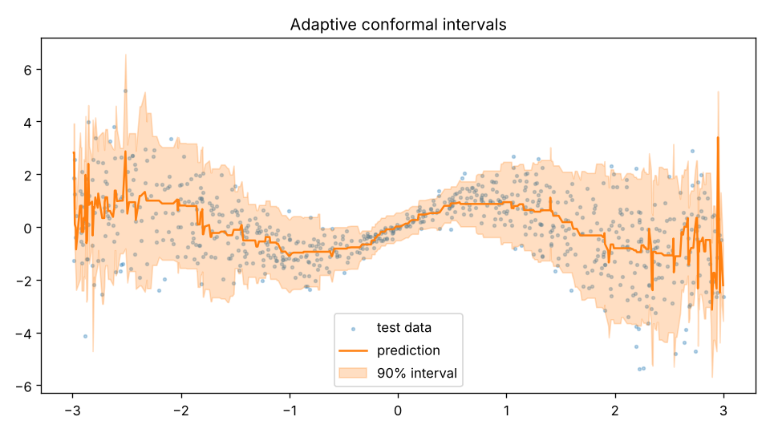

# Adaptive Conformal Prediction Intervals

Turns any scikit-learn regressor into one that reports a prediction **interval** with a statistical coverage guarantee, and makes the interval wider where the model is less certain.

## How it works
1. A gradient-boosting model predicts the value.
2. A second model learns how large the error usually is at each input.
3. On a held-out calibration set, errors are divided by that learned spread and the right quantile is taken (split conformal prediction).
4. Intervals are `prediction ± quantile × spread`, so they adapt to noisy regions.

## Run
```bash
pip install -r requirements.txt
python conformal.py
```
Prints coverage for 80/90/95% targets and saves `intervals.png`.

## Results (synthetic data, noise grows with |x|)
| Target | Empirical coverage | Mean width |
| --- | --- | --- |
| 80% | 82.1% | 2.76 |
| 90% | 92.3% | 3.67 |
| 95% | 96.0% | 4.35 |

Coverage lands at or just above each target, as the method promises.



## Limitations
Guarantee assumes calibration and test data come from the same distribution. Single synthetic experiment, not a benchmark.
