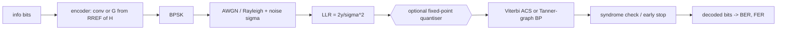
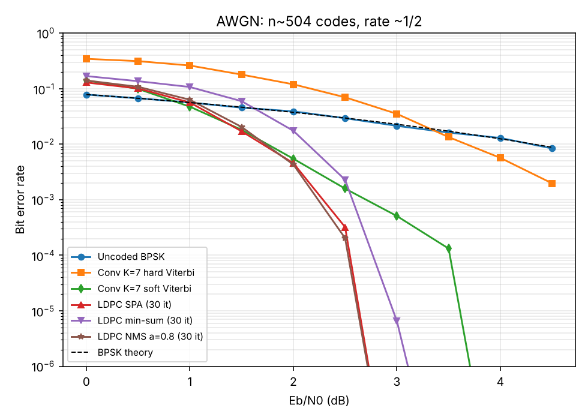
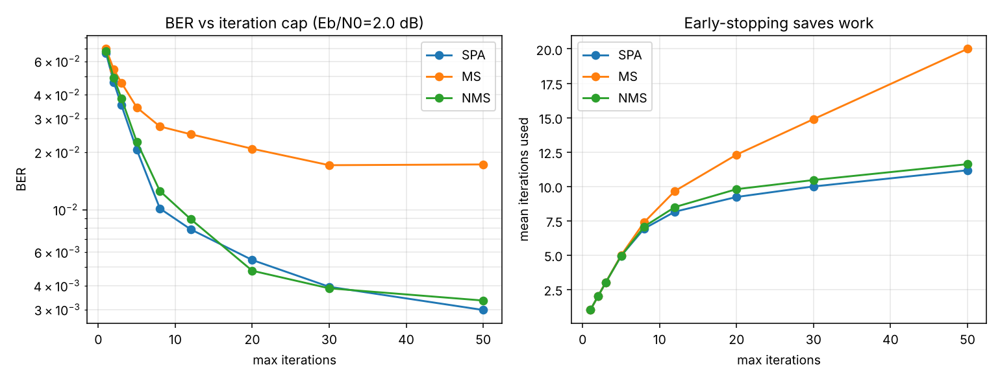
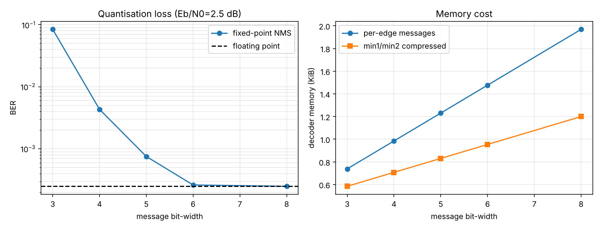
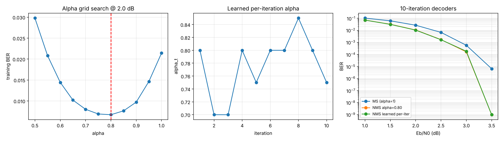
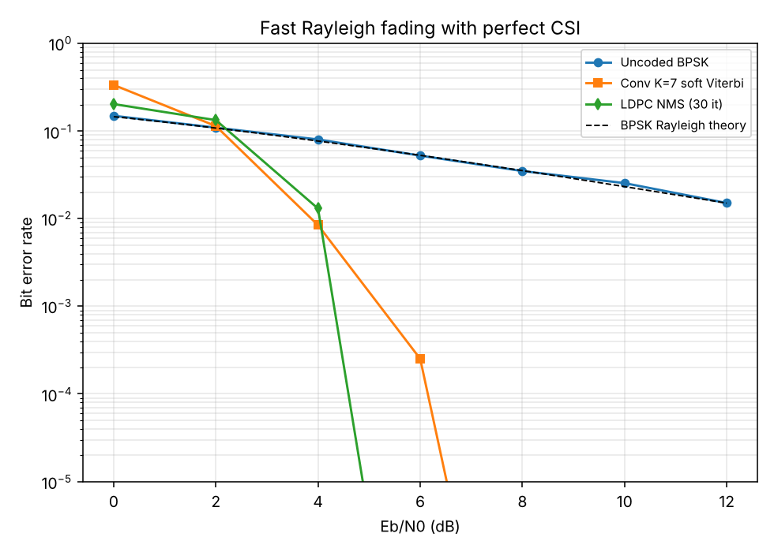

# Channel Coding Lab: Viterbi vs. LDPC, and what fixed-point hardware costs

A from-scratch, fully vectorised simulator that pits a classic **K=7 convolutional code with
Viterbi decoding** against a **rate-1/2 (3,6)-regular LDPC code** (n=504) with four iterative
decoders (sum-product, min-sum, normalised min-sum, offset min-sum) over AWGN and Rayleigh
fading. The second half asks the *embedded-systems* question: how few bits can the decoder's
messages use before the code stops working, and how much SRAM does that save?

## Motivation

Every wireless link, flash drive and deep-space probe is held together by error-correcting codes.
For an ECE student the interesting part is the gap between the textbook decoder (floating-point
sum-product) and what actually ships in silicon (a few bits per message, min-sum approximations,
early termination). This project quantifies each approximation instead of just asserting it.

## ECE concepts

**Channel model.** BPSK maps bit 0 to +1 and bit 1 to -1. With code rate R and energy per
information bit Eb, symbol energy is Es = R Eb and

    sigma^2 = N0/2 = 1 / (2 R 10^(Eb/N0 [dB] / 10))

The channel log-likelihood ratio is `L = 2y / sigma^2` (AWGN) or `2 h y / sigma^2` (fading gain h).
Uncoded BPSK has `BER = Q(sqrt(2 Eb/N0))`; with Rayleigh fading `BER = 0.5 (1 - sqrt(g/(1+g)))`.
The BI-AWGN capacity is integrated numerically; the Shannon limit for R=1/2 comes out at
**0.187 dB** Eb/N0, the target every code is chasing.

**Convolutional code + Viterbi.** Generators (133, 171) octal, 64 states, zero-terminated.
Branch metric `sum_j (1-2c_j) L_j` is maximised by dynamic programming (add-compare-select).
Hard decisions throw away the reliability information, which costs about 2 dB.

**LDPC + message passing.** A sparse parity-check matrix H defines the code; the Tanner graph
carries LLR messages between variable nodes (n) and check nodes (m).

    SPA:       c2v_j = 2 atanh( prod_{i != j} tanh(v2c_i / 2) )
    min-sum:   c2v_j = prod_{i != j} sign(v2c_i) * min_{i != j} |v2c_i|
    NMS:       c2v_j <- alpha * c2v_j          (alpha < 1)
    OMS:       c2v_j <- sign * max(|c2v_j| - beta, 0)
    v2c_i = L_i + sum_{other checks} c2v



**Fixed-point decoding.** Messages are clipped and rounded to `b` bits
(`q(x) = clip(round(x/step), +-(2^(b-1)-1)) * step`), exactly what a hardware datapath does.
Check-node memory can be compressed by storing only (min1, min2, argmin index, sign bits) per check.

## Architecture

| Module | Role |
| --- | --- |
| `codinglab/channel.py` | BPSK, AWGN, Rayleigh, LLRs, theory curves, BI-AWGN capacity and Shannon limit |
| `codinglab/gf2.py` | GF(2) RREF, rank, systematic generator construction |
| `codinglab/convolutional.py` | Trellis tables, encoder, batch soft/hard Viterbi |
| `codinglab/ldpc.py` | Gallager construction with local-search 4-cycle removal, Tanner tables |
| `codinglab/decoders.py` | SPA / MS / NMS / OMS flooding decoders with per-frame early stop and a quantiser hook |
| `codinglab/quantized.py` | Saturating fixed-point quantiser, memory cost model |
| `codinglab/tuning.py` | Alpha grid search and per-iteration "unfolded" alpha learning (no backprop) |
| `codinglab/simulate.py` | Monte-Carlo BER/FER engine, scheme classes |
| `codinglab/cli.py` | Experiments and figure generation |
| `tests/test_all.py` | 22 tests (theory vs simulation, code properties, decoder behaviour) |

The LDPC generator is obtained by row-reducing H over GF(2); the code found has n=504, k=254
(rate 0.504) and is free of length-4 cycles. The convolutional scheme uses 252 information bits
(+6 tail), so both schemes carry roughly the same payload at nearly the same rate.

## How to run

```bash
pip install -r requirements.txt
python -m pytest -q                       # 22 tests, ~1 s
python -m codinglab.cli all               # all experiments, ~1.5-4 min, writes results/
python -m codinglab.cli compare --max-frames 3000   # one experiment, more frames
python -m codinglab.cli quant --quant-ebn0 3.0 --max-llr 10
```

Options: `--n` (block length, multiple of 6), `--seed`, `--max-frames`, `--iters-ebn0`,
`--quant-ebn0`, `--tune-ebn0`, `--max-llr`, `--out`. Results here use `--max-frames 600`.

## Results

### 1. Code and decoder comparison over AWGN (`results/compare_ber.png`)



| Eb/N0 (dB) | Uncoded | Conv hard | Conv soft | LDPC SPA | LDPC MS | LDPC NMS 0.8 |
| --- | --- | --- | --- | --- | --- | --- |
| 1.5 | 4.6e-2 | 1.8e-1 | 1.8e-2 | 1.7e-2 | 6.0e-2 | 2.0e-2 |
| 2.0 | 3.9e-2 | 1.2e-1 | 5.5e-3 | 4.6e-3 | 1.7e-2 | 4.3e-3 |
| 2.5 | 2.9e-2 | 7.0e-2 | 1.6e-3 | 3.2e-4 | 2.3e-3 | 2.0e-4 |
| 3.0 | 2.1e-2 | 3.5e-2 | 5.1e-4 | <1e-6 | 6.6e-6 | <1e-6 |

(Uncoded BER is quoted per information bit with no coding gain; the coded schemes spend half
their energy on redundancy yet win by orders of magnitude once Eb/N0 is above ~1.5 dB.)

Observations:

* Soft-decision Viterbi beats hard-decision by roughly 2 dB, the well-known soft-decision gain.
* The LDPC code (SPA/NMS) is on par with soft Viterbi at 1.5 to 2 dB, pulls ahead above that, and is already error-free
  in 600 frames at 3 dB, while soft Viterbi still shows errors at 3.5 dB. Waterfall slope is
  much steeper for LDPC.
* Below ~1.5 dB (e.g. 1.0 dB: 4.7e-2 vs 5.6e-2) the convolutional code is actually *better*: at n=504 the LDPC code has not
  reached its asymptotic regime and plain min-sum is clearly handicapped there.
* Plain min-sum loses about 0.5 dB to SPA because it over-estimates message magnitudes.
  A single scalar `alpha = 0.8` recovers nearly all of it (NMS curve is on top of SPA).
* Points showing 0 are plotted at a 1e-9 floor: they mean "no errors in the frames simulated",
  not a true BER of zero.

### 2. Iterations and early termination (`results/iterations.png`)



At Eb/N0 = 2 dB, BER falls steadily as the iteration cap grows (SPA 6.6e-2 at 1 iteration to
3.0e-3 at 50). Min-sum plateaus near 1.7e-2 while NMS tracks SPA to within ~10%. Average iteration
count with early stopping is far below the cap (11.6 for NMS with a 50-iteration cap), so a
hardware decoder that checks the syndrome can run at a fraction of worst-case latency and energy.

### 3. Fixed-point message width (`results/quantization.png`)



Eb/N0 = 2.5 dB, NMS alpha=0.8, 20 iterations, LLR clipping at +-12:

| bits | BER | naive memory | compressed memory |
| --- | --- | --- | --- |
| float | 2.5e-4 | - | - |
| 8 | 2.5e-4 | 15.8 KiB | 9.6 KiB |
| 6 | 2.6e-4 | 11.8 KiB | 7.6 KiB |
| 5 | 7.5e-4 | 9.8 KiB | 6.6 KiB |
| 4 | 4.3e-3 | 7.9 KiB | 5.7 KiB |
| 3 | 8.4e-2 | 5.9 KiB | 4.7 KiB |

Down to **6 bits there is no measurable loss**; 5 bits costs about 3x in BER (roughly 0.1 to 0.2 dB
by the waterfall slope); 4 bits and below falls apart because the quantiser step (1.7 LLR units
at 4 bits) is too coarse for small-magnitude messages, so correct decisions get rounded to zero.
Storing only min1/min2/index/signs per check node cuts message memory by 21% (3 bits) to 39% (8 bits),
see `metrics.json`.

### 4. Tuning the normalisation factor (`results/tuning.png`)



A grid search on 300 training frames at 2 dB picks `alpha = 0.8`. The per-iteration learner
(coordinate descent on a logistic surrogate loss, 10 unfolded iterations) ends at values between
0.7 and 0.85 with the loss only moving from 0.0307 to 0.0299. On a held-out seed the 10-iteration
decoders compare as:

| Eb/N0 | MS | NMS 0.8 | NMS learned |
| --- | --- | --- | --- |
| 2.0 | 2.7e-2 | 1.1e-2 | 1.0e-2 |
| 3.0 | 5.8e-4 | 1.6e-4 | 1.8e-4 |

Normalisation is worth 2.5x or more in BER; per-layer learning adds nothing statistically
significant at this block length. A negative result, reported honestly.

### 5. Rayleigh fading (`results/fading_ber.png`)



With independent fades and perfect channel-state information, uncoded BPSK decays only as 1/SNR
(1.5e-2 at 12 dB). Both codes exploit the diversity from many independently faded symbols: soft
Viterbi reaches 2.5e-4 at 6 dB and LDPC shows no errors at 6 dB. Soft Viterbi is ahead at 4 dB (8.5e-3 vs 1.3e-2); LDPC wins from 6 dB.

## Comparison summary

| Question | Answer from the experiments |
| --- | --- |
| Soft vs hard decisions | ~2 dB for Viterbi |
| SPA vs min-sum | ~0.5 dB penalty for min-sum, removed by alpha = 0.8 |
| Does early stopping matter? | Mean iterations ~ 4 to 12 vs a 20 to 50 cap |
| Minimum bit-width | 6 bits lossless, 5 bits borderline, <=4 bits unusable with this clipping |
| Conv vs LDPC | Conv wins below ~1.5 dB, LDPC wins in the waterfall at similar rate and block length |

## Limitations

* Monte-Carlo budgets are small (600 frames per point, stop at 30 frame errors), so BER values
  below ~1e-4 are noisy, and the error-floor region of the LDPC code is never reached.
* A single code instance (seed 0) is used; random Gallager codes vary by a few tenths of a dB.
* The quantiser clips at a fixed +-12 and uses a uniform step; a real design would optimise the
  clip level and scaling per SNR (the `--max-llr` option allows a manual sweep).
* Flooding schedule only. Layered scheduling converges in roughly half the iterations.
* The memory model counts message storage only, not the routing network or Viterbi path memory.
* Rayleigh results assume perfect CSI and independent fades per symbol (ideal interleaving).
* The learned-alpha procedure is gradient-free and used a small training set.

## Ideas for next steps

Layered min-sum scheduling, quasi-cyclic LDPC (as in 5G NR) for hardware-friendly structure,
puncturing for rate adaptation, density-evolution thresholds, and an RTL-style cycle-accurate
model of a Viterbi add-compare-select unit.
