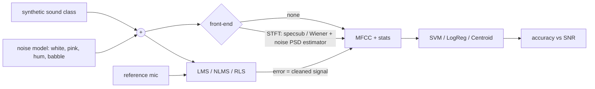

# Audio denoising lab: spectral filters, adaptive noise cancellation, and noisy-sound classification

A from-scratch (NumPy/SciPy only for filters and FFT) study of three classic ECE signal-processing answers to
*"my microphone signal is dirty"*, and what each one does to a downstream ML classifier:

1. **Single-channel spectral denoisers**: spectral subtraction, decision-directed Wiener filtering, and three noise-PSD estimators (initial frames, running-minimum statistics, VAD-gated).
2. **Two-microphone adaptive noise cancellation**: LMS, NLMS and RLS FIR filters versus a fixed 60 Hz notch comb for mains hum, with step-size, filter-length, forgetting-factor sweeps and a tracking test (the acoustic path changes mid-run).
3. **Sound classification under noise**: a hand-written MFCC front-end (mel filterbank + DCT-II) feeding SVM / logistic regression / nearest-centroid, evaluated with and without denoising and with clean vs multi-condition training.

Everything is synthetic (five generated sound classes and four noise models), deterministic by seed, and runs in about 25 s.

## Motivation

A sensor node on a robot or a hearing device sees `x[n] = s[n] + v[n]`. Whether to clean the signal *before* the model, train the model on noisy data, or add a reference microphone is a real system-design tradeoff (compute, latency, hardware cost). This project measures that tradeoff instead of assuming denoising always helps. Spoiler: it often does not, and the reasons are instructive.

## ECE concepts and key equations

Short-time Fourier transform with periodic Hann window `w` (75% overlap, perfect reconstruction by weighted overlap-add):

    X[t,k] = sum_n x[n + tH] w[n] e^{-j2πkn/N}        x̂[n] = sum_t IFFT(X̂[t])·w / sum_t w²

Spectral subtraction with over-subtraction `α` and spectral floor `β`:

    |Ŝ|² = max(|X|² − α·P_v, β·P_v),        gain G = sqrt(|Ŝ|² / |X|²)

Decision-directed Wiener filter (Ephraim–Malah) with a-priori SNR `ξ`:

    ξ[t,k] = a·|Ŝ[t−1,k]|²/P_v[k] + (1−a)·max(γ[t,k] − 1, 0),   G = max(ξ/(1+ξ), G_min),   γ = |X|²/P_v

Adaptive noise canceller (primary `d = s + g·(h * v)`, reference `u ≈ v`, error `e = d − wᵀu` is the speech estimate):

    LMS:   w ← w + μ e u
    NLMS:  w ← w + μ e u / (ε + uᵀu)
    RLS:   k = Pu/(λ + uᵀPu),  w ← w + k e,  P ← (P − k uᵀP)/λ

Evaluation uses SNR, **SI-SDR** (scale-invariant SDR, `10 log10(‖αs‖²/‖αs − ŝ‖²)`), segmental SNR, log-spectral distance, filter misalignment `‖w−h‖²/‖h‖²`, and MFCC = `DCT-II(log(Mel · |STFT|²))`.



## Architecture

| Module | Role |
| --- | --- |
| `audiolab/signals.py` | 5 sound generators (siren, vowel-like formant pulses, clicks, rain-like AM noise, chirp), 4 noise models, exact-SNR mixing |
| `audiolab/stft.py` | STFT / ISTFT, spectrograms |
| `audiolab/spectral.py` | spectral subtraction, decision-directed Wiener, initial/min-statistics noise PSD, 60 Hz notch comb |
| `audiolab/vad.py` | energy VAD with hangover, VAD-gated noise PSD, VAD-driven denoisers |
| `audiolab/adaptive.py` | LMS, NLMS, RLS, random acoustic-path model, misalignment metric |
| `audiolab/features.py` | mel filterbank, DCT-II, MFCC, clip-level embedding (38-D) |
| `audiolab/classifier.py` | model zoo, noisy evaluation with pluggable front-end |
| `audiolab/metrics.py` | SNR, SI-SDR, segmental SNR, LSD |
| `audiolab/experiments.py` | all experiments; `plots.py` figures; `cli.py` entry point |

## How to run

```bash
pip install -r requirements.txt
python -m pytest -q                       # 25 tests
python -m audiolab.cli all --out results  # ~25 s, writes figures + metrics.json
python -m audiolab.cli adaptive --seed 3  # run one study
python -m audiolab.cli all --quick        # tiny smoke run
```

Commands: `denoise`, `adaptive`, `classify`, `all`. Options: `--out DIR`, `--seed N`, `--quick`.

## Results

All numbers below come from `results/metrics.json` (seed 0). Figures: `results/denoise_sweep.png`, `spectrograms.png`, `adaptive_convergence.png`, `adaptive_sweeps.png`, `classification.png`.

### 1. Single-channel denoising (output SI-SDR in dB; input SI-SDR equals the input SNR)

| noise | input SNR | noisy | spectral subtraction | Wiener (DD) |
| --- | --- | --- | --- | --- |
| white | -5 | -5.0 | -3.8 | -6.1 |
| white | 0 | 0.0 | 1.3 | -0.9 |
| white | 5 | 5.0 | 5.8 | 3.2 |
| white | 10 | 10.0 | 9.7 | 6.2 |
| white | 15 | 15.0 | 12.6 | 8.4 |
| babble | 0 | 0.0 | 2.0 | -1.0 |
| babble | 5 | 5.0 | 6.3 | 3.0 |
| babble | 15 | 15.0 | 12.8 | 8.3 |

Spectral subtraction gains 1-2 dB at 0 to 5 dB input SNR and becomes a net **loss** above about 10 dB; Wiener with decision-directed smoothing is worse on SI-SDR everywhere in this setup. SI-SDR penalizes the temporal smearing and attenuation of non-stationary sounds (sirens, clicks), and the min-statistics tracker partly absorbs steady tonal content into the "noise" estimate. This is the well-known gap between noise reduction and signal fidelity.

### 2. Noise-PSD estimation strategy (bursty sound inside silence, Wiener filter)

| input SNR | noisy | min-statistics | VAD-gated |
| --- | --- | --- | --- |
| 5 dB | 5.0 | 4.6 | 12.1 |
| 10 dB | 10.0 | 7.6 | 17.8 |
| 15 dB | 15.0 | 9.7 | 22.8 |

When silence exists, freezing the noise estimate during activity (VAD gating) is worth roughly **+7 dB** over the running minimum, which is the largest single improvement in the project. At 0 dB the energy VAD fails (precision 0.40, recall 0.11) and the gain shrinks to +1.6 dB: the front-end is only as good as its detector.

### 3. Adaptive cancellation (reference microphone available)

Single-run convergence (16 000 samples, 16-tap unknown path, noise 0.7x amplitude, input SI-SDR 3.1 dB):

| algorithm | final misalignment | output SI-SDR |
| --- | --- | --- |
| LMS (μ=0.002) | -13.3 dB | 16.4 dB |
| NLMS (μ=0.5) | -20.7 dB | 4.2 dB |
| RLS (λ=0.999) | -13.9 dB | 20.2 dB |

NLMS has the best weight misalignment yet the worst SI-SDR: with a large step the weights jitter whenever speech (which is uncorrelated with the reference but still in `e`) drives the update, so the *cleaned signal* is noisy even though the average filter is accurate. This is the textbook misadjustment-versus-convergence tradeoff, visible in the sweeps below.

### 4. Parameter sweeps (output SI-SDR, dB)

| LMS μ | 0.0005 | 0.001 | 0.002 | 0.004 | 0.008 |
| --- | --- | --- | --- | --- | --- |
| SI-SDR | 13.0 | 14.7 | 14.7 | 13.3 | 11.0 |

| NLMS μ | 0.05 | 0.1 | 0.25 | 0.5 | 1.0 | 1.5 |
| --- | --- | --- | --- | --- | --- | --- |
| SI-SDR | 13.9 | 11.8 | 7.9 | 4.2 | -0.7 | -5.6 |

| NLMS taps | 4 | 8 | 16 | 32 | 64 |
| --- | --- | --- | --- | --- | --- |
| SI-SDR | 2.0 | 3.4 | 4.2 | 4.3 | 4.3 |

| RLS λ | 0.99 | 0.995 | 0.999 | 0.9998 |
| --- | --- | --- | --- | --- |
| SI-SDR | 10.5 | 13.1 | 18.0 | 20.6 |

LMS has an interior optimum near μ = 1e-3 to 2e-3 (slow convergence on the left, misadjustment on the right). NLMS wants a *small* normalized step (≤ 0.1) when the desired signal is present. Filters shorter than the true path (16 taps) cannot cancel the tail of the response; longer filters add nothing. RLS likes long memory when the path is stationary.

### 5. Tracking a path change at the midpoint (SI-SDR after the change)

| filter | post-switch SI-SDR |
| --- | --- |
| NLMS μ=0.5 | 4.6 |
| RLS λ=0.999 | 14.8 |
| RLS λ=0.99 | 10.9 |

With a stationary path the long window wins even after the switch, because this switch is a single event; with frequent changes the shorter window would take over. The memory of an RLS filter is about 1/(1−λ) samples (1000 vs 100 here).

### 6. Mains hum (60 Hz + 4 harmonics, SI-SDR dB, input 4.4)

| method | SI-SDR |
| --- | --- |
| reference-based RLS | 23.3 |
| fixed notch comb (Q=30) | 15.1 |
| spectral subtraction | 0.2 |
| reference-based NLMS | -2.5 |

RLS beats a hand-designed notch comb by 8 dB because it matches the exact path gain and phase per harmonic. NLMS fails here: a sum of five sinusoids gives the input autocorrelation matrix a huge eigenvalue spread, so the slowest modes converge far too slowly. Whitening-by-RLS is exactly what is needed. The notch comb needs no reference but also removes speech energy near 60 Hz multiples.

### 7. Classification under noise (SVM on 38-D MFCC statistics; 5 classes, 12 test clips per class)

Clean-trained model accuracy on clean test data: **1.00**.

| noise / SNR | no front-end | spectral sub. | Wiener | multi-condition trained (no front-end) |
| --- | --- | --- | --- | --- |
| white / 0 dB | 0.40 | 0.20 | 0.47 | 0.98 |
| white / 5 dB | 0.40 | 0.32 | 0.60 | 1.00 |
| white / 10 dB | 0.40 | 0.60 | 0.60 | 1.00 |
| babble / 5 dB | 0.40 | 0.40 | 0.53 | 1.00 |
| babble / 10 dB | 0.40 | 0.52 | 0.60 | 1.00 |

A model trained only on clean clips collapses to 40% even at 10 dB, and denoising recovers only part of the gap (best case 60%). Training on noisy data (multi-condition training) gets about 98 to 100%, far better than any front-end. Applying a denoiser *on top of* a noise-trained model hurts (white 0 dB: 0.98 → 0.82 with Wiener, 0.70 with spectral subtraction) because the denoiser moves test features away from the distribution the model saw. Classifier comparison at 5 dB white noise, clean-trained: logistic regression gains from Wiener (0.40 → 0.58) and so does SVM (0.40 → 0.58), nearest-centroid less (0.40 → 0.50).

## Takeaways

- Denoising for a *machine* is not denoising for an *ear*: metrics that rise (SNR) and accuracy that rises are different objectives.
- A good noise estimate matters more than a good gain rule: VAD gating (+7 dB) dwarfs the Wiener-versus-subtraction difference.
- A reference sensor changes the problem: with a correlated reference, RLS reaches over 20 dB where single-channel methods reach about 0.
- On an edge budget, training data augmentation is cheaper (zero inference cost) and more effective than a front-end filter; the front-end adds about one STFT/ISTFT pair per frame.

## Limitations

- Synthetic sounds only (five narrow classes); real datasets would have more intra-class variation and different failure modes.
- Small test sets (60 clips per cell) mean accuracy has roughly ±6% standard error; single-seed tables should be read as trends.
- The min-statistics tracker is a simplified Martin estimator (no optimal bias compensation); VAD is plain energy-based and fails at 0 dB.
- Adaptive filters are time-domain FIR with a perfectly synchronized reference and a short, minimum-phase-ish path. No double-talk detector, no frequency-domain or subband implementations, no fixed-point effects.
- RLS costs O(L²) per sample, so it would need a lattice or fast-RLS variant on a microcontroller.
- Classifier hyperparameters were not tuned; only one embedding was tested.
