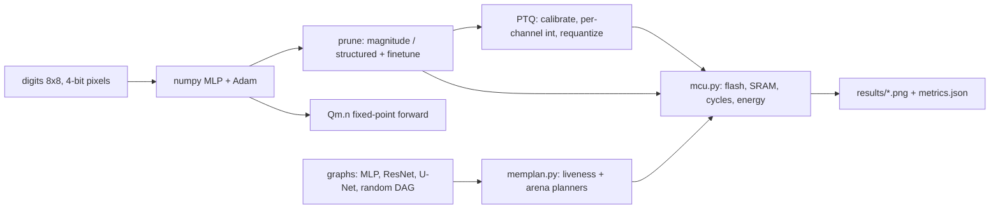
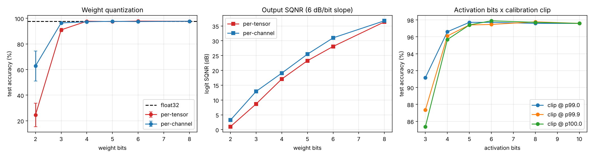
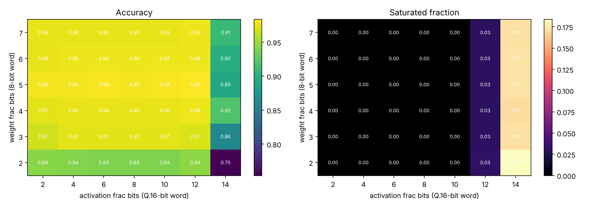
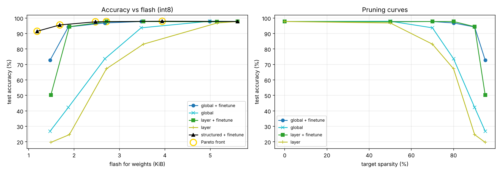
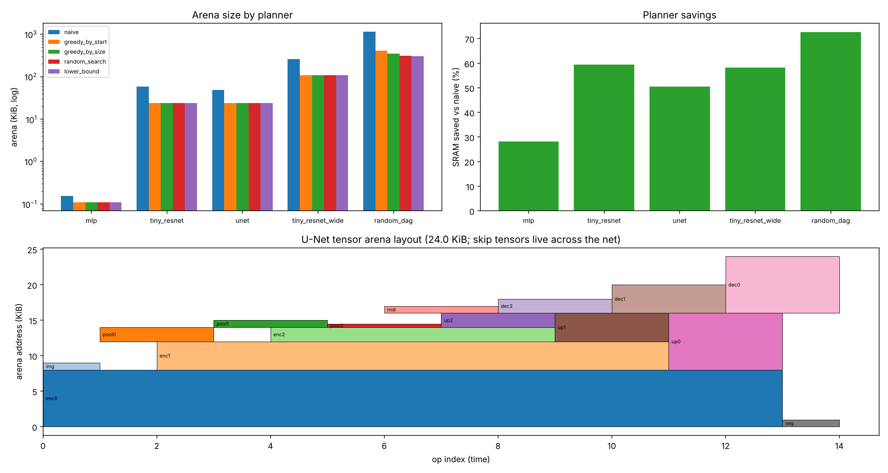
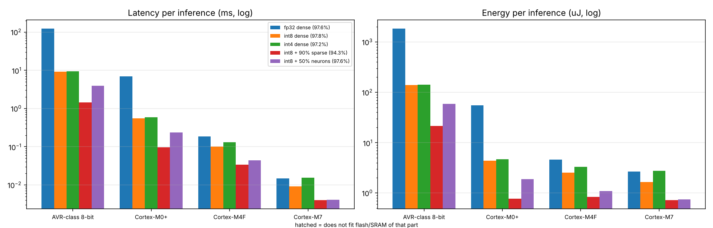

# TinyML MCU lab: quantization, pruning, SRAM planning and cost models

Area: **Embedded and edge** (ECE). A small, fully reproducible toolkit that takes a trained
neural network and answers the question an embedded engineer actually asks:
*"Will this fit on my microcontroller, how fast will it run, and what did I lose in accuracy?"*

Everything runs in plain numpy: the integer inference engines use only integer arithmetic
(int64 accumulators emulate a 32-bit MAC unit plus a 64-bit multiply), so the numerics match what
firmware would do, bit for bit, apart from the C code itself.

## Motivation

A Cortex-M0+ has tens of KiB of SRAM and no FPU. A float32 MLP that is trivial on a laptop is a
problem there for three separate reasons, each handled by a module here:

1. **Arithmetic cost.** float32 on a core with no FPU is software-emulated (~90 cycles/MAC).
   Integer MACs are 10-15x cheaper. -> `quant.py`
2. **Storage.** Weights live in flash; fewer bits and fewer nonzeros mean a smaller part. -> `quant.py`, `prune.py`
3. **Working memory.** Activations live in SRAM, and the *schedule and address assignment* of
   intermediate tensors decides the peak. -> `memplan.py`

`mcu.py` ties them together with a first-order cycle/energy/fit model for four core classes.

## ECE concepts

**Affine/symmetric quantization.** A real weight is `w ~ s * q` with `q` a signed integer in
`[-(2^(b-1)-1), 2^(b-1)-1]`. Each output channel `c` gets its own scale `s_c = max|w_c| / q_max`.
An integer layer computes

```
acc_c = sum_i x_q[i] * w_q[i,c] + b_q[c]            (int32 MAC, bias at scale s_x * s_w[c])
y_q   = clamp( round( acc_c * (s_x * s_w[c] / s_y) ) )   (requantization)
```

The real multiplier `M = s_x s_w / s_y` is stored as `M0 * 2^-n` with `M0` an int32 in
`[2^30, 2^31)` (`quantize_multiplier`), so rescaling costs one multiply and one shift, the same
trick used by gemmlowp and TFLite-Micro.

**SQNR rule of thumb.** Uniform quantization noise power is `Delta^2/12`, so every extra bit
buys ~6.02 dB of SQNR: `SQNR ~ 6.02 b + 1.76 - (headroom loss)`. The sweep below reproduces
the ~5-6 dB/bit slope on real network logits.

**Qm.n fixed point.** A signed word with `m` integer bits and `n` fractional bits represents
`x = raw / 2^n` with range `[-2^(m-1), 2^(m-1) - 2^-n]` and resolution `2^-n`. A product of a
`Qa.wf` and a `Qb.af` number has `wf + af` fractional bits, so after accumulation we shift right by
`wf` (with rounding) to return to `af` fractional bits, and saturate. More fractional bits -> finer
resolution but smaller range: the trade-off is a real design decision with no per-layer scale to
save you.

**Tensor-arena planning.** Each activation tensor `t` is live over `[first_t, last_t]` (op
indices). Two tensors may share addresses iff lifetimes are disjoint. The lower bound on arena
size is `max_t sum_{live at t} size`. Optimal packing is NP-hard (dynamic storage allocation), so
firmware runtimes use heuristics.

**CSR sparsity.** Unstructured pruning only pays off if the index overhead is smaller than the
saved weights: `bytes_csr = nnz*(wbits + ceil(log2 cols))/8 + 2(rows+1)`.



## Architecture

| Module | Role |
| --- | --- |
| `tinyml_lab/data.py` | digits dataset (pixels in [0,1]), calibration subset |
| `tinyml_lab/model.py` | numpy MLP, Adam trainer with pruning masks |
| `tinyml_lab/quant.py` | per-tensor/channel weight quantization, calibration, integer `QMLP`, Qm.n `fixed_forward` |
| `tinyml_lab/prune.py` | magnitude masks (global/layer), structured neuron removal, CSR cost |
| `tinyml_lab/memplan.py` | liveness analysis, 4 arena planners, validator, MLP/ResNet/U-Net/random graphs |
| `tinyml_lab/mcu.py` | AVR-class, M0+, M4F, M7 cost model (flash, SRAM, latency, energy) |
| `tinyml_lab/experiments.py` | the sweeps; return JSON-able dicts |
| `tinyml_lab/plots.py`, `cli.py` | figures and the command line |

## How to run

```bash
pip install -r requirements.txt
python -m pytest -q                       # 21 tests, ~3 s
python -m tinyml_lab.cli all --out results  # everything, ~7 s
python -m tinyml_lab.cli quant            # or: prune | plan | mcu
python -m tinyml_lab.cli prune --wbits 4 --ft-epochs 30 --seeds 5
```

Outputs: `results/fig_quantization.png`, `fig_fixed_point.png`, `fig_pruning_pareto.png`,
`fig_memplan.png`, `fig_mcu.png` and `results/metrics.json` (all numbers quoted below).

## Results and analysis

Task: 8x8 digits, MLP 64-48-32-10 (4,928 weights), 70/30 stratified split.
Float32 test accuracy: **97.6 %**. Quantization numbers are means over 3 trained seeds.

### 1. Weight bits and per-channel scales (int8 activations)

| weight bits | 2 | 3 | 4 | 5 | 6 | 8 |
| --- | --- | --- | --- | --- | --- | --- |
| per-tensor acc % | 24.6 | 91.0 | 97.8 | 97.5 | 97.8 | 97.7 |
| per-channel acc % | 62.8 | 96.4 | 97.3 | 97.7 | 97.5 | 97.7 |
| per-tensor logit SQNR dB | 1.0 | 8.7 | 17.1 | 23.3 | 28.1 | 36.4 |
| per-channel logit SQNR dB | 3.2 | 12.9 | 19.1 | 25.5 | 31.0 | 36.8 |



- Down to 4 bits the network is statistically indistinguishable from float; the cliff is at 2-3 bits.
- Per-channel scaling is worth roughly **2-4 dB** of SQNR at low bit widths and rescues 2-bit
  weights from chance-level (24.6 %) to 62.8 %: one outlier column no longer sets the step size for all.
  At 8 bits the two are equivalent (36.4 vs 36.8 dB).
- SQNR slope is ~5-6 dB/bit as theory predicts until it saturates against the activation quantizer.
- Activations (right panel): 3-4 bits hurt; clipping calibration at the 99th percentile beats
  max-calibration at 3 bits (91.2 % vs 85.4 %) because resolution matters more than rare outliers, and
  the effect vanishes by 6+ bits. Widest accumulator seen with int8: **20 bits**, so a 32-bit MAC has ample headroom.

### 2. Qm.n fixed point: range vs resolution



Float weights reach |w| = 1.50 and activations reach 28.9. With a 16-bit activation word, 14
fractional bits leaves only 1 integer bit and activations saturate (accuracy falls to 0.75-0.92);
at <= 10 fractional bits everything fits. For 8-bit weights, 2-3 fractional bits (resolution
0.25-0.125) already loses 1-4 points, while >= 4 is flat at ~98 %. The sweet spot is the diagonal
where `max|x| < 2^(word - 1 - frac)`: no per-layer scale factors are needed at all, which is
attractive on hardware with no fast multiplier for requantization.

### 3. Pruning



| sparsity | global, no finetune | global + finetune | layer-wise + finetune | flash (B, int8, CSR where cheaper) |
| --- | --- | --- | --- | --- |
| 0 % | 97.8 | 97.8 | 97.8 | 5738 |
| 70 % | 93.7 | 97.8 | 97.8 | 3562 |
| 80 % | 73.7 | 96.9 | 97.8 | 2743 |
| 90 % | 42.2 | 94.3 | 94.4 | 1918 |
| 95 % | 26.9 | 72.8 | 50.2 | 1507 |

- Fine-tuning with fixed masks is the whole game: at 80 % sparsity it recovers 73.7 % -> 96.9 %.
- Global magnitude pruning wins at extreme sparsity (95 %: 72.8 % vs 50.2 %) because it keeps
  the small last layer dense while gutting the large first layer.
- Unstructured sparsity saves flash (5.7 KiB -> 1.9 KiB at 90 %) but CSR indices take a big bite:
  the 50 %-sparse model only shrinks ~11 %, since dense storage is chosen where it is cheaper.
- Structured neuron removal gives a smaller *dense* net: keeping 50 % of hidden neurons
  (64-24-16-10) costs 0.2 points (97.6 %) and saves 56 % of the flash, with no index overhead.

### 4. SRAM arena planning



| graph | tensors | lower bound | naive | greedy start | greedy size | random search |
| --- | --- | --- | --- | --- | --- | --- |
| mlp | 4 | 112 B | 156 B | 112 | 112 | 112 |
| tiny_resnet 32x32 | 15 | 24.0 KiB | 59.0 KiB | 24.0 | 24.0 | 24.0 |
| unet 32x32 | 15 | 24.0 KiB | 48.5 KiB | 24.0 | 24.0 | 24.0 |
| tiny_resnet_wide 48x48 | 15 | 108 KiB | 258.8 KiB | 108 | 108 | 108 |
| random DAG (40 ops) | 41 | 306.4 KiB | 1143.5 KiB | 410.2 | 348.8 | 313.5 |

On CNN-shaped graphs, every heuristic hits the lower bound and the planner is simply a free
**50-60 % SRAM saving**. It decides whether a model deploys at all: `tiny_resnet` (24.6 KiB with
runtime) fits a 36 KiB Cortex-M0+ planned but not naive (59 KiB); `tiny_resnet_wide` fits a 128 KiB
M4F only when planned. On an adversarial random DAG the heuristics diverge: greedy-by-start is 34 %
above the bound, greedy-by-size 14 %, and 300 random restarts get within 2.3 %.

### 5. End-to-end deployment (MLP) across MCU classes



| design | acc % | flash B | SRAM B | MACs | M0+ latency | M4F latency |
| --- | --- | --- | --- | --- | --- | --- |
| fp32 dense | 97.6 | 20,072 | 960 | 4,928 | 6.93 ms | 0.185 ms |
| int8 dense | 97.8 | 5,738 | 624 | 4,928 | 0.55 ms | 0.101 ms |
| int4 dense | 97.2 | 3,274 | 624 | 4,928 | 0.59 ms | 0.132 ms |
| int8 + 90 % sparse | 94.3 | 1,918 | 624 | 493 | 0.096 ms | 0.034 ms |
| int8 + 50 % neurons | 97.6 | 2,530 | 600 | 2,080 | 0.234 ms | 0.044 ms |

Take-aways: int8 gives 3.5x flash and **12.6x latency on the FPU-less M0+** with no accuracy loss.
int4 saves flash but is *slower* than int8 (nibble unpacking), a classic trade-off. The 8-bit AVR-class part runs fp32 at
123 ms but int8 at 9 ms. Structured pruning is the best accuracy-per-microjoule point on the
M0+ (97.6 %, 1.9 uJ vs 55.4 uJ for fp32: a **29x** energy cut).

## Limitations

- The MCU model is first-order (cycles/MAC constants per core class, no caches, no memory wait
  states, no DMA, no CMSIS-NN kernel specifics). It ranks design points; it does not predict them.
- Digits is tiny and easy; ranking of methods at 2-3 bits may differ on harder tasks. The CNN
  graphs in the planner study are shape-only (no trained weights).
- Activations use signed symmetric quantization even after ReLU, wasting one bit; unsigned
  activation quantization would help the 3-4 bit rows.
- PTQ only: no quantization-aware training, which is the standard fix for the 2-3 bit collapse.
- One float model (seed 0) is used for the pruning, fixed-point and MCU tables; only the
  quantization sweeps average over seeds, and the three seeds happen to reach the same float accuracy.
- Planner is for sequential op execution with no in-place ops or operator-internal scratch buffers.

## Extensions

Quantization-aware training with a straight-through estimator, unsigned post-ReLU activations,
in-place ops in the planner (elementwise add can reuse an input), and emitting a C header with
the quantized weights plus a generated `int main()` to check bit-exactness against this numpy engine.
