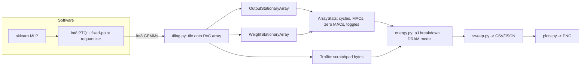
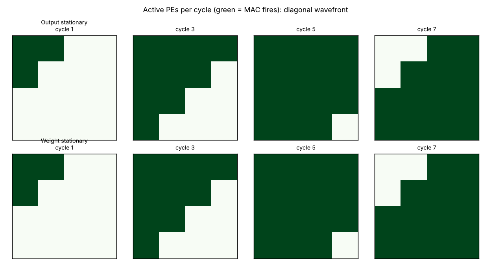
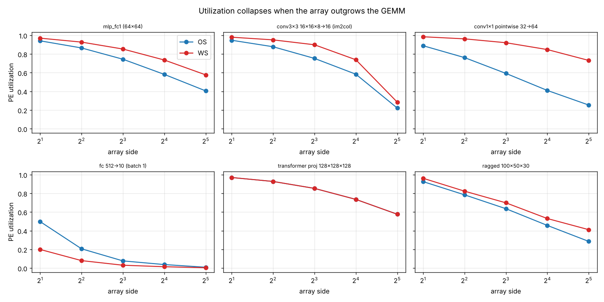
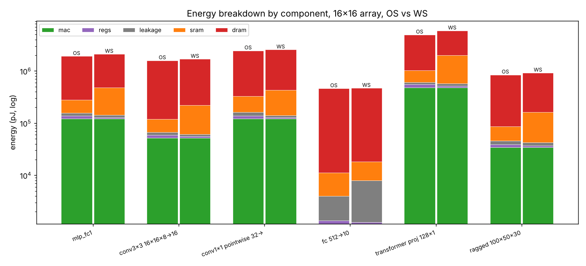
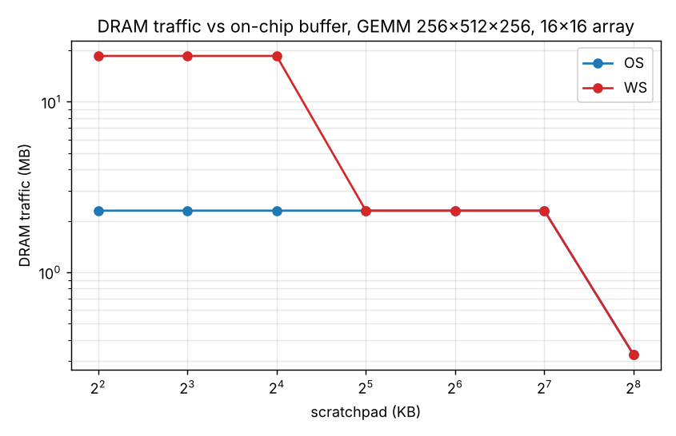
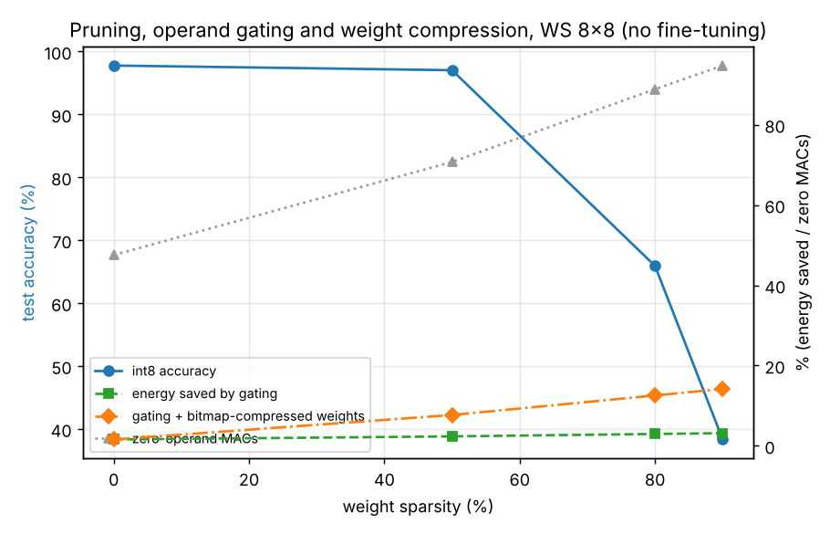

# Systolic-array accelerator lab

A cycle-accurate, register-level simulator of the matrix engine at the heart of modern NPUs and TPUs, written in
plain NumPy. It models **output-stationary (OS)** and **weight-stationary (WS)** int8 systolic arrays, tiles
arbitrary GEMMs onto a fixed array, attaches a first-order **energy / DRAM-traffic model**, validates closed-form
cycle models against the simulation, and finally runs a **quantized int8 MLP end-to-end on the simulated
hardware**, bit-exact against NumPy. It closes with a pruning study: how much energy does zero-operand gating
and compressed weight storage actually save?

## Motivation

Almost every neural-network FLOP is a matrix multiply, and the dominant ECE question is not "can we multiply" but
"how do we keep thousands of multipliers fed without burning energy moving data". A systolic array answers with
local, neighbour-to-neighbour communication: each operand is fetched from the scratchpad once and then reused
across a whole row or column of PEs. This project makes that tangible: you can watch the wavefront, count cycles,
and see exactly why a 32x32 array is a poor fit for a batch-1 fully connected layer.

## ECE concepts

| Concept | Where it appears |
| --- | --- |
| Systolic dataflow, skewed input injection | `pe_array.py` |
| Pipeline fill / drain latency | `K + M + N - 2` compute cycles per tile |
| Fixed-point / integer arithmetic (int8 x int8 -> int32) | `quant.py`, `pe_array.py` |
| Requantization with a normalised mantissa + shift | `quant.to_fixed_multiplier`, `requantize_fixed` |
| Memory hierarchy: scratchpad vs DRAM, energy per access | `energy.py` |
| Dynamic power proxy (register bit toggles), clock gating | `pe_array.toggles`, `energy.py` |
| Roofline-style utilization analysis | `tiling.ideal_cycles`, `overlapped_cycles` |

Key equations. For an `R x C` array computing `C = A·B` with `A: M x K`, `B: K x N` (one tile):

```
OS: PE(i,j) sees A[i,k] and B[k,j] at cycle  t = i + j + k
    compute cycles = K + M + N - 2,  drain = M,  cycles/tile = K + 2M + N - 2
WS: PE(k,j) holds W[k,j]; psums move down; C[m,j] exits column j at  t = m + (K-1) + j
    cycles/tile = K (preload) + M + K + N - 2
utilization = MACs / (R · C · cycles)          energy = Σ_component (events × pJ/event)
```

The tile counts are `ceil(M/R)·ceil(N/C)` (OS) and `ceil(K/R)·ceil(N/C)` (WS).

## Architecture



Package layout:

```
sysarray/
  quant.py      symmetric int8 quantization, fixed-point requantize, SQNR
  pe_array.py   cycle-accurate OS and WS arrays, ArrayStats, toggle counter
  tiling.py     tiled GEMM driver, closed-form cycle/traffic models, overlap bound
  energy.py     EnergyParams, DRAM traffic with scratchpad capacity, EDP
  mlp.py        train / prune / quantize / run MLP on injectable matmul backend
  sweep.py      workload x array-size x dataflow sweeps, SRAM sweep, sparsity study
  verify.py     randomized self-check: simulator vs NumPy vs closed forms
  plots.py      figures;  cli.py / __main__.py  command-line entry point
tests/          39 tests (simulator, tiling, quant/energy, MLP)
results/        CSV / JSON / PNG produced by `python -m sysarray all`
```

How the simulation works: each cycle, every PE latches the operand arriving from its left/top neighbour
(`a_in = concat(injected_column, a_reg[:, :-1])`), multiplies, and accumulates. Skew is *not* programmed in; it
falls out of when the edge injectors fire. A `valid` bit travels with each operand so MACs are counted only when
real data meets real data, which is how pipeline bubbles show up as lost utilization.

## How to run

```bash
pip install -r requirements.txt
python -m pytest -q                 # 39 tests, ~3 s
python -m sysarray all              # verify + sweeps + MLP + all figures, ~5 s
python -m sysarray verify --cases 100
python -m sysarray sweep --sizes 4,8,16,64 --sram-kb 64
python -m sysarray mlp --mlp-sizes 4,8 --n-eval 200 --hidden 96
```

Options: `--out DIR`, `--sizes`, `--sram-kb`, `--mlp-sizes`, `--n-eval`, `--hidden`, `--cases`, `--seed`.

## Results

### 1. Correctness

`verify` runs 24 random GEMMs (random shapes up to 40, random array shapes) through both dataflows: 48/48 results
are bit-exact against NumPy, and the closed-form cycle count, MAC count and scratchpad traffic equal the
simulator's exactly (`results/verify.json`). `results/wavefront.png` shows the diagonal activity wave:



### 2. Dataflow x array size (analytic model, validated above)

Excerpt from `results/gemm_sweep.csv` (cycles are serial tile execution; "overlap" is the double-buffered bound):

| Workload (M,K,N) | Array | OS cycles | WS cycles | OS util | WS util | Overlapped bound | Ideal |
| --- | --- | --- | --- | --- | --- | --- | --- |
| MLP fc1 (128,64,64) | 8 | 11008 | 9600 | 0.74 | 0.85 | 8214 | 8192 |
| MLP fc1 (128,64,64) | 32 | 1264 | 888 | 0.41 | 0.58 | 606 | 512 |
| 1x1 conv (256,32,64) | 16 | 4992 | 2416 | 0.41 | 0.85 | 2094 | 2048 |
| 1x1 conv (256,32,64) | 32 | 2016 | 700 | 0.25 | 0.73 | 606 | 512 |
| im2col conv3x3 (196,72,16) | 32 | 994 | 774 | 0.22 | 0.28 | 598 | 221 |
| FC 512->10, batch 1 | 16 | 522 | 1312 | 0.038 | 0.015 | 558 | 20 |
| Square 128^3 | 16 | 11136 | 11136 | 0.74 | 0.74 | 8238 | 8192 |



Observations:

- **Bigger is not faster for small GEMMs.** Going from 8x8 to 32x32 (16x more PEs) speeds up the MLP layer by only
  8.7x (OS) / 10.8x (WS) and the 3x3 conv by 4.7x / 5.1x; utilization falls to 22-28 % on the conv because
  N=16 cannot fill 32 columns.
- **WS wins when K is small and M is large** (1x1 conv: 2.9x fewer cycles than OS at 32x32) because the weight
  tile is loaded once and a long activation stream amortises it; OS pays skew fill/drain per output tile.
- **OS wins at batch 1** (M=1): WS must preload K weight rows to process one activation row, 2.5x slower than OS.
- **Overlap matters.** Double-buffering tiles removes the per-tile skew penalty and gets within 1-2 % of the
  roofline on large GEMMs (e.g. 8238 vs 8192 cycles for 128^3 at 16x16), but cannot rescue ragged shapes.

### 3. Energy and memory



With the default 45 nm-style constants, DRAM is 66-98 % of energy in every workload; the MAC
term is a few percent. Between dataflows, **WS spends 1.0-1.2x the energy of OS** on these workloads at 16x16
because int32 partial sums are written to and re-read from the scratchpad once per K-tile (`sram_write` is larger,
`regs` is smaller since only one operand register toggles). Scratchpad sizing is a cliff, not a slope:



For GEMM 256x512x256 on 16x16, OS needs 2.3 MB of DRAM traffic at any buffer up to 128 KB and only collapses to
the compulsory 0.33 MB once everything fits (256 KB). WS is worse at small buffers: below 32 KB its int32 partial
sums spill (18.5 MB, 8x more) -- a classic example of why accumulator buffering sizes a WS design.

### 4. Quantized MLP on the simulated hardware

A 64-64-10 MLP is trained on sklearn digits (float accuracy 97.8 %). Post-training int8 quantization with
fixed-point requantization also gives **97.8 %**. Running 96 test samples through the simulated arrays gives
predictions identical to the NumPy int reference for all 6 (dataflow, size) configurations
(`results/mlp_results.json`, `bit_exact: true`).

| Array | OS cycles | WS cycles | OS util | WS util | OS energy (nJ) | WS energy (nJ) |
| --- | --- | --- | --- | --- | --- | --- |
| 4x4 | 33696 | 32192 | 0.84 | 0.88 | 2380 | 3302 |
| 8x8 | 10248 | 9392 | 0.69 | 0.76 | 2242 | 2666 |
| 16x16 | 3264 | 2816 | 0.54 | 0.63 | 2172 | 2346 |

Utilization drops as the array grows because the 10-wide logits layer and 64-wide hidden layer cannot fill it.

### 5. Pruning, operand gating and compressed weights (WS 8x8, no fine-tuning)



| Weight sparsity | int8 accuracy | zero-operand MACs | energy saved: gating only | gating + bitmap weights |
| --- | --- | --- | --- | --- |
| 0 % | 97.8 % | 47.5 % | 1.6 % | 1.6 % |
| 50 % | 97.0 % | 70.7 % | 2.4 % | 7.7 % |
| 80 % | 65.9 % | 88.9 % | 3.0 % | 12.6 % |
| 90 % | 38.3 % | 94.7 % | 3.2 % | 14.2 % |

Even a dense model has 47 % zero-operand MACs (ReLU outputs and blank pixels), yet gating those MACs saves
only 1.6 % of total energy, because the MAC is not where the energy goes. Compressing the weight stream saves 3-4x more.
Magnitude pruning without fine-tuning is safe to about 50 % sparsity and breaks down beyond that, so the
practical sweet spot here is ~50 % sparsity with compressed weights (-7.7 % energy for -0.8 pt accuracy).

## Limitations

- Energy constants are order-of-magnitude, not from a specific PDK; trust rankings and trends, not absolute pJ.
- Leakage is a flat per-PE-cycle cost; no clock-tree, no SRAM leakage, no voltage or frequency scaling.
- The simulator charges a serial (non-overlapped) schedule; the overlapped number is an idealised closed form.
- DRAM model is first order: operand reuse by scratchpad capacity only, no burst or bank effects.
- Pruning has no fine-tuning, so accuracy loss beyond 50 % is pessimistic; per-tensor quantization only.
- Accumulators are int64 in simulation; real hardware uses int32 (test shows worst case 64x128x128 fits easily, but
  very deep K could overflow int32 in hardware).
- Operand-register toggles are counted only for 8-bit operand registers, not for partial-sum registers.
- Analytic toggle counts assume a 50 % activity factor and ignore data correlation.
