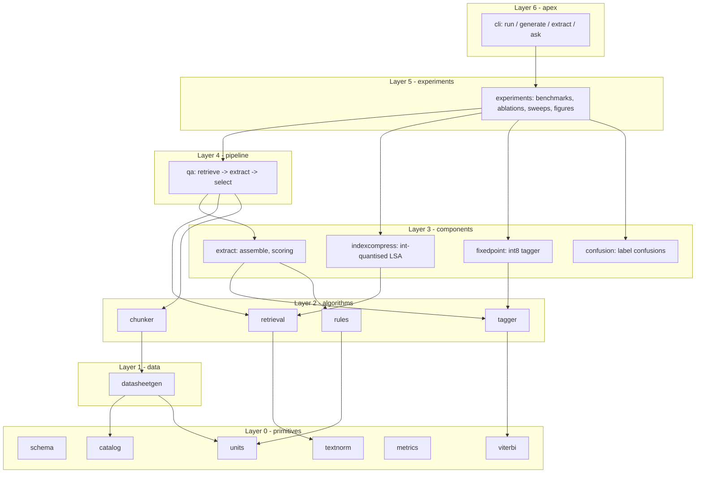
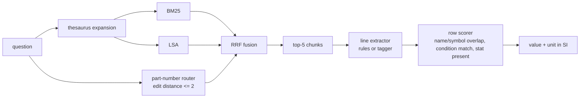
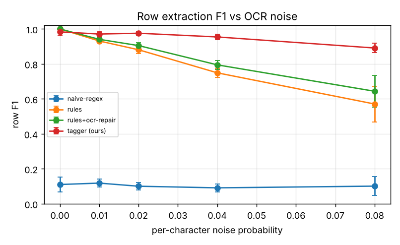
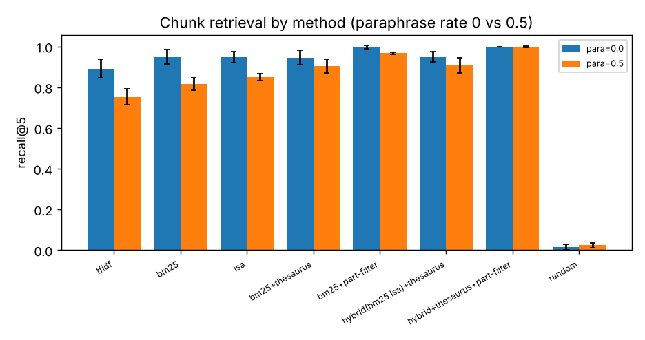
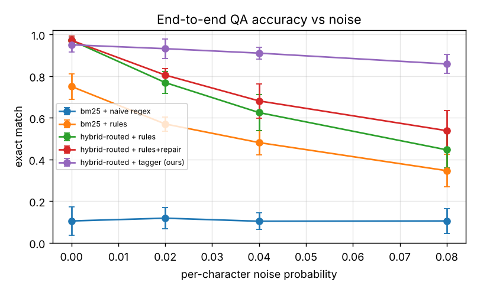
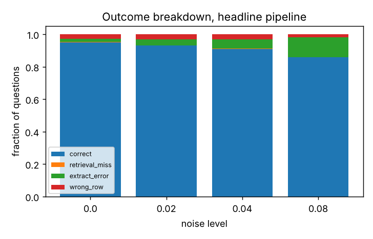
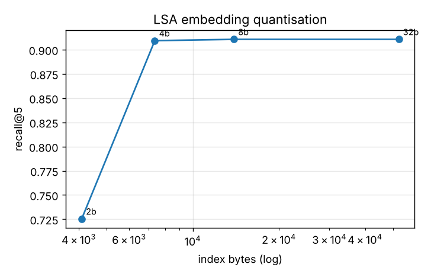

# Datasheet spec-extraction and retrieval lab (flagship)

Can a small, CPU-only, dependency-light pipeline pull a *number with a unit* out of a noisy datasheet table and answer
"what is the maximum dropout voltage of the TLV1234 at IOUT = 500 mA?" correctly? This project builds that pipeline from
scratch (tokenizer, unit algebra, structured-perceptron tagger with Viterbi decoding, BM25 / TF-IDF / LSA retrieval,
reciprocal-rank fusion, int-quantised index) and measures where it works and where it breaks.

Everything in this README was produced by running the code in this folder; every number in the tables below is copied
from `results/tables.md`, which is written by `dsl run`. The full run takes about {{RUNTIME}} s on one CPU core.

> **Scope warning.** All datasheets here are *synthetic*: generated from a catalogue of five component families
> (LDO, op-amp, ADC, buck converter, MCU) with plausible value ranges. No real vendor datasheet is used and no claim is
> made about performance on real PDFs. See "Limitations and threats to validity".

## 1. Problem and real-world relevance

Component selection is a retrieval-plus-reading task: an engineer scans dozens of datasheets for a handful of numbers
(quiescent current, GBW, switching frequency) whose *meaning depends on a unit, a statistic (min/typ/max) and a test
condition*. Getting the unit or the condition wrong is a silent error (5 uA vs 5 mA, 100 mA vs 500 mA load). Datasheets
reach text through PDF extraction or OCR, which damages tables in two characteristic ways that this lab models explicitly:

1. **Character confusions** (digit/letter look-alikes such as 0/O, 1/l, 5/S, and `m` read as `rn`).
2. **Column-gap loss** (a pipe or multi-space gap collapses to one space), which breaks column-count based parsers.

The engineering questions are: how fast do hand-written parsers degrade; does a learned sequence tagger recover; what do
we lose by shrinking the index for an edge device; and what actually fails end to end?

## 2. Related approaches (only works I am certain exist)

- **BM25**: Robertson and Zaragoza, "The Probabilistic Relevance Framework: BM25 and Beyond", Foundations and Trends in IR, 2009.
- **Latent semantic analysis**: Deerwester et al., "Indexing by Latent Semantic Analysis", JASIS, 1990.
- **Structured perceptron**: Collins, "Discriminative Training Methods for Hidden Markov Models: Theory and Experiments with Perceptron Algorithms", EMNLP 2002.
- **Reciprocal rank fusion**: Cormack, Clarke and Buttcher, "Reciprocal Rank Fusion Outperforms Condorcet and Individual Rank Learning Methods", SIGIR 2009.
- **Viterbi decoding**: Viterbi, "Error bounds for convolutional codes and an asymptotically optimum decoding algorithm", IEEE Trans. Information Theory, 1967.
- **Edit distance**: Levenshtein, "Binary codes capable of correcting deletions, insertions and reversals", 1966.

I did not look any of these up during this run; they are cited from memory for the *method definitions* only, and no
numerical claim in this README depends on them.

## 3. Method

### 3.1 Pyramid architecture

The package is a strict pyramid: each module imports only from layers *below* it (enforced by `tests/test_pyramid.py`
using `ast`, which also checks that the apex CLI transitively depends on every module).



| Layer | Modules | Role |
|---|---|---|
| 0 | `schema`, `units`, `textnorm`, `viterbi`, `metrics`, `catalog` | Data classes, SI unit algebra, tokenisation/edit distance, Viterbi, ranking metrics and CIs, component catalogue. No project imports. |
| 1 | `datasheetgen` | Synthetic datasheet generator with token-level gold labels and OCR/gap noise; question generator. |
| 2 | `chunker`, `rules`, `tagger`, `retrieval` | Passage chunking, hand-written parsers and naive baseline, perceptron tagger, BM25/TF-IDF/LSA/thesaurus/RRF. |
| 3 | `extract`, `indexcompress`, `fixedpoint`, `confusion` | Tag-to-row assembly and extraction scoring; quantised index and byte accounting; int-quantised tagger inference; token confusion analysis. |
| 4 | `qa` | End-to-end question answering with stage-wise failure attribution. |
| 5 | `experiments` | Config-driven experiment runner (benchmarks, ablations, sweeps, multiple seeds, figures, tables). |
| 6 | `cli` | Command-line apex: `dsl run | generate | extract | quantize | ask`. |

### 3.2 End-to-end data flow



### 3.3 Unit algebra

A unit string is split into an SI prefix and a base (`mV`, `kSPS`, `uA/MHz`); compound units are ratios.
`to_si(v, u)` returns `v * scale` and a canonical dimension (`A/Hz`). Two values match when dimensions are equal and SI
values agree to a relative tolerance of 1e-3, so `5 uA` and `0.005 mA` are the same answer while `5 mA` is not.

### 3.4 Tagger (structured perceptron with Viterbi)

Each table line is tokenised (column gaps become a `SEP` token) and every token receives one of nine labels
(`O, NAME, SYM, COND, MIN, TYP, MAX, UNIT, SEP`). The score of a label path y for tokens x is

    s(x, y) = sum_t  w[y_t] . phi(x, t)  +  sum_t  T[y_{t-1}, y_t]

with hashed binary features phi in four groups: lexical (keyword, suffix), shape (character classes, number/unit/dash
flags), context (shape and word of tokens at offsets -2..+2) and position (number of column gaps before/after).
Decoding uses the Viterbi recurrence

    delta_t(j) = max_i [ delta_{t-1}(i) + T[i, j] ] + e_t(j)

and training is the averaged structured perceptron: on a mistake, `w[gold] += phi`, `w[pred] -= phi` and the same for
the transition counts, with weights averaged over all updates. Tagged tokens are assembled into a row; the assembler can
undo OCR digit look-alikes (`l2O -> 120`) and `rn -> m` in units.

### 3.5 Retrieval

- **BM25** with the Lucene idf `ln(1 + (N - n + 0.5)/(n + 0.5))`, `k1 = 1.5`, `b = 0.75`.
- **TF-IDF** with sublinear tf, `idf = ln((1+N)/(1+df)) + 1` and L2 normalisation, cosine scoring.
- **LSA**: truncated SVD of the TF-IDF matrix, `X ~ U_k S_k V_k^T`; documents live at `U_k S_k`, a query is folded in as `q V_k`.
- **Thesaurus expansion**: if every word of any name/alias of a catalogue parameter appears in the query, the other names
  and the symbol are added with weight 0.5.
- **RRF**: `score(d) = sum_i 1 / (60 + rank_i(d))` over BM25 and LSA rankings.
- **Part router**: query tokens containing a digit are matched to the known part numbers by Levenshtein distance <= 2
  (this absorbs typos); matching chunks are promoted above all others.
- **Context header ablation**: chunks may carry a `[part | section]` prefix (`header=True`) or not.

### 3.6 Memory-budget angle (index and model)

LSA document embeddings can be quantised per row to signed b-bit integers, `q = round(x / s)`, `s = max|x| / (2^(b-1) - 1)`,
so the per-element error is at most `s/2` (tested). The index size is `n k b / 8 + 4 n` bytes (one float32 scale per row)
versus `4 n k` bytes in float32.

The tagger itself can run in fixed point (`fixedpoint.QuantTagger`): each label column of the weight table is quantised to
signed b-bit integers with its own scale, emission scores are accumulated in int32 per token and rescaled once, and only
the 9 x 9 transition matrix stays float. Because the 32768 x 9 hashed table is mostly zero, a sparse encoding stores only
non-zero weights as (int32 index, packed value) pairs.

## 4. Experimental setup

- **Data.** For each seed a fresh corpus of {{NTEST}} parts (cycling through the five families), each rendered in one of
  three layouts (`pipe`, `space`, `inline`); ~25 lines per document including distractors (pin descriptions with
  `1 uF` style units, feature bullets, an absolute-maximum-ratings table that reuses the row format).
  The tagger is trained on {{NTRAIN}} separate parts per seed (noise 0.02) and never sees test parts.
- **Noise model.** Per-character confusion probability `p` (digits to look-alike letters, `m -> rn` in text cells) and a
  column-gap collapse probability of `min(0.3, 2.5 p)`. Gold labels and gold values are always the clean ones.
- **Questions.** {{NQ}} questions per seed; 50% use a paraphrase (alias) of the parameter name where one exists, 15% have a
  one-character typo in the part number, and condition rows always state their condition.
- **Seeds and statistics.** {{NSEEDS}} seeds (0-4); all tables report mean ± 95% Student-t half-width over seeds (n = {{NSEEDS}}).
- **Extraction metric.** A predicted row counts as correct only if the unit dimension matches, all of min/typ/max match in
  SI (relative 1e-3, missing must be missing) and the name is within edit distance 2 of the gold name. Precision, recall and
  F1 are micro-averaged over lines, so a spurious row on a distractor line costs precision.
- **QA metric.** Exact match: right dimension and SI value within 1e-3 relative error.
- **Baselines.** Extraction: naive regex, hand-written rules, rules + OCR repair. Retrieval: random, TF-IDF, BM25, LSA,
  BM25 + thesaurus, BM25 + part router, hybrid variants. End to end: five pipelines (see T5).
- **Configs.** `configs/default.json` is the full run; `dsl run --quick` is a smoke configuration used by CI.

## 5. Validation against references

Base and middle layers were checked against independent implementations or textbook values (`tests/test_reference.py`;
run `python tests/test_reference.py` to regenerate this table). The BM25 reference is a plain-python re-derivation of the
same formula, so it validates the sparse-matrix implementation rather than the formula itself.

{{VALID}}

## 6. Results

### 6.1 Extraction under OCR noise

{{P0}}



- The naive regex baseline (every `number unit` pair is a value) reaches only about 0.10 F1 at every noise level: it
  confuses test conditions with values and emits rows for pin/feature lines.
- Hand-written rules are perfect on clean text and fall to 0.571 ± 0.102 at noise 0.08. OCR repair recovers part of that
  (0.644 ± 0.090) but not all, because corrupted column structure cannot be repaired by fixing characters.
- The tagger (trained once at noise 0.02) loses only a little at the high end (0.891 ± 0.027 at 0.08) but is *worse* than
  the rules on perfectly clean text (0.983 vs 1.000): a learned model trained on slightly noisy data is not free of error
  where a rule is exact.

### 6.2 Tagger ablations

{{P1}}

Removing the context features is by far the most damaging change (0.754 vs 0.977 F1), followed by position features
(0.881). The Viterbi transition model (0.964 vs 0.977), shape or lexical features, and OCR repair in assembly (0.948 vs
0.977) each cost less than 0.03 F1 and their intervals overlap with the full model at n = 5 seeds, so I do not claim they
are individually significant at this sample size.

### 6.3 Layout shift

{{P2}}

This is the most important caveat for the tagger. A tagger that never saw the `inline` layout during training scores
0.000 on it, i.e. it does not generalise to unseen layouts at all; trained on all three layouts it reaches 0.946 on
inline lines, still below the rules written for that layout (1.000 at this noise level, because inline text has no column
structure for noise to break).

### 6.4 Retrieval

Questions with paraphrase rate 0 (names copied from the datasheet) and 0.5, with and without the chunk context header:

{{P3}}

{{P4}}

{{P5}}



- LSA beats BM25 at recall@1 once names are paraphrased (0.460 vs 0.320), and the thesaurus raises BM25 recall@5 from
  0.816 to 0.904. Caveat: the thesaurus is built from the same catalogue that supplied the aliases used to paraphrase
  questions, so this gain is an upper bound that real, independently written synonym lists would not reach.
- The part-number router is the decisive component. Without the context header BM25 recall@5 is 0.563, with the router
  0.968; the full hybrid with the router reaches 0.999. Recall@1 is lower (0.577 with the header) because several chunks
  of the right part contain similar-looking rows, which is why a row-level selector follows retrieval.
- Random chunk selection is near zero everywhere, so the corpus is not trivially easy.
- The thesaurus slightly *lowers* recall@1 for BM25 on unparaphrased questions (0.461 to 0.429, overlapping intervals):
  expansion adds noise when it is not needed.

### 6.5 End-to-end question answering

{{P6}}



The five pipelines isolate each contribution. Routing and fusion lift clean accuracy from 0.751 (BM25 + rules) to 0.972.
With noise, the rule-based pipelines degrade steeply (0.805 at noise 0.02 and 0.539 at 0.08 even with OCR repair) while the
tagger pipeline holds 0.932 and 0.859. At zero noise the rules-based pipeline is marginally ahead (0.972 vs 0.951, intervals overlap).

{{P7}}



Outcomes are attributed per question: `retrieval_miss` (gold chunk not in the top 5), `extract_error` (gold line is
mis-extracted by the extractor), `wrong_row` (the gold line extracts fine but another row was selected). With routing,
retrieval misses are essentially absent; the growth in errors with noise is almost entirely extraction errors
(16 to 92 of 750 questions), while row-selection errors stay roughly constant (14 to 22).

### 6.6 Parameter sweeps and the memory-budget result

{{P8}}

{{P9}}

{{P10}}



- LSA alone peaks at k = 64 in this corpus (0.849) and degrades at k = 128 (0.777); k = 8 is useless (0.152). The routed
  hybrid is insensitive to k because the router already isolates the right part.
- Smaller chunks raise recall@1 (0.675 at 2 lines vs 0.420 at 8) while end-to-end accuracy changes little
  (0.963 vs 0.940, overlapping intervals).
- 8-bit and 4-bit quantisation leave retrieval essentially unchanged (recall@5 0.911, 0.911 and 0.909 for 32, 8 and 4 bits) while shrinking
  the dense index 3.8x and 7.1x; 2 bits collapses it (0.725). The BM25 sparse index for the same corpora is 28.6 kB, so the
  4-bit LSA index is smaller than it, although I did not compare their accuracy on identical questions in this sweep.

### 6.7 Fixed-point tagger, profiling and token confusions

{{P11}}

- int8 and int6 weights give the same row F1 as the float model (0.960 vs 0.959, a difference far inside the intervals);
  int4 is still close (0.956); int3 drops to 0.895 and int2 collapses (0.367 ± 0.263). The "float64 reference" row is
  counted at float32 storage (1.18 MB dense). A dense int8 table is 295 kB; storing only non-zero weights takes 11.5 kB at
  8 bits and 5.5 kB at 4 bits, roughly two orders of magnitude below the dense float table.

{{P12}}

- Timings are wall-clock numpy/python on this sandbox CPU and are only indicative. The tagger costs about 0.25 ms per line
  against a few microseconds for regex rules, and the integer path is not faster than the float path here: it is a
  numerical-fidelity and footprint test, not a speed result (numpy has no int8 dot advantage for this gather-and-sum).

{{P13}}

The tagger's weakest labels are MIN and TYP (F1 0.887 and 0.904 at noise 0.08); the two largest confusions are TYP/MIN
swaps (73 and 57 tokens), consistent with collapsed gaps making a lone number ambiguous between neighbouring columns.

### 6.8 Failure-case analysis

At noise 0.08 the tagger's extraction errors over all seeds were dominated by rows with the right line but wrong fields
(123) rather than missed rows (15). Examples saved in `results/results.json` under `extraction_failures`:

| category | example line (as seen by the tagger) | visible damage |
|---|---|---|
| wrong fields | `Maxirnum Output Current (IOUT): min 0.766 A` | `m` read as `rn` in the name cell |
| wrong fields | `Storage Temperature TSTG   -   -55 - 150 degC` | collapsed gaps leave dashes and values adjacent |
| wrong fields | `Resolution   N   - -   16   -   bit` | collapsed gap between two dash cells |
| missed row | `Slew Rate SR \| - \| - O.347 \| - \| V/us` | collapsed gap plus `0 -> O` |
| missed row | `Signal-to-Noise Ratio   SNR   fIN = 10 kHz   - 51.1 -   dB` | collapsed gaps |

I did not diagnose every one of the 123 wrong-field rows individually; the table lists representative cases only.
End-to-end examples of each failure category (question, expected, got) are stored under `qa.examples` in `results.json`.

## 7. Limitations and threats to validity

- **Synthetic data.** The generator and the rule parsers were written by the same author with knowledge of each other, so
  the rules are close to optimal on clean synthetic text. Real datasheets have multi-line cells, footnotes, graphs and
  ranges (`1.8 V to 5.5 V`, `+/-1`) that are not modelled.
- **Leakage in the thesaurus.** Thesaurus entries and paraphrase aliases share one catalogue (see 6.4).
- **Part router uses corpus metadata.** Without the router most retrieval methods fall far; a real deployment needs a part
  identifier in the query or a metadata field.
- **Noise model** is character substitution plus gap collapse; it does not model skew, dropped lines or merged columns.
- **Tagger is layout-specific.** It fails completely on a layout absent from training (6.3).
- **Name matching tolerance** (edit distance 2) was chosen by me and is lenient; stricter matching would lower every
  extraction number.
- **Small n.** Five seeds give wide t-intervals (see ± values); only differences much larger than the interval are claimed.
- **Single-hop questions** only; no multi-part comparison or unit-conversion questions.

## 8. Future work

- Run on real datasheet text (publicly available PDFs converted with an open-source extractor) and report the gap.
- Replace the hand-written feature set with character n-gram embeddings and test layout generalisation again.
- Learn the row selector (currently a hand-weighted overlap score) from the 14-22 wrong-row failures per level.
- Evaluate a local small language model as a fallback reader for lines the tagger rejects, with the same unit-aware scorer.
- Port the integer tagger to a real microcontroller toolchain and measure RAM/latency there (here only numerical fidelity and byte counts are measured, in numpy).

## 9. How to run

```bash
pip install -e ".[test]"          # or: pip install -r requirements.txt  (then set PYTHONPATH=src)
pytest -q                         # {{NTESTS}} tests
dsl run --config configs/default.json --out results     # about {{RUNTIME}} s, writes results/*.png, results.json, tables.md
dsl run --quick --out /tmp/quick                         # smoke run (a few seconds)
dsl generate --style space --noise 0.04 --seed 3         # print a noisy synthetic datasheet
dsl extract "Slew Rate | SR | - | - | 12 | - | V/us"     # parse one line with rules and the tagger
dsl ask "What is the typical Quiescent Current of the <part>?" --seed 0
python tests/test_reference.py                           # regenerate the validation table
```

## 10. Repository layout

```
src/dsl/            18 modules in 7 layers (see 3.1), {{LOC_SRC}} non-blank lines
tests/              {{NTESTS}} tests in 10 files, {{LOC_TESTS}} non-blank lines
configs/default.json
results/            results.json, tables.md, 5 figures (all produced by dsl run)
.github/workflows/ci.yml
pyproject.toml, requirements.txt
```

The test files are organised by layer (`test_layer0` ... `test_layer4`, `test_fixedpoint`, `test_confusion`, `test_experiments`) plus `test_pyramid.py`
(import direction and apex coverage) and `test_reference.py` (independent ground truth).

*Not financial, medical or safety advice; component values are synthetic and must not be used for real designs.*
