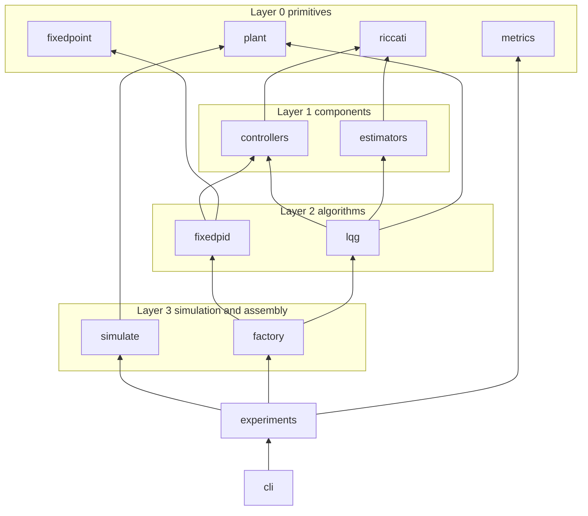
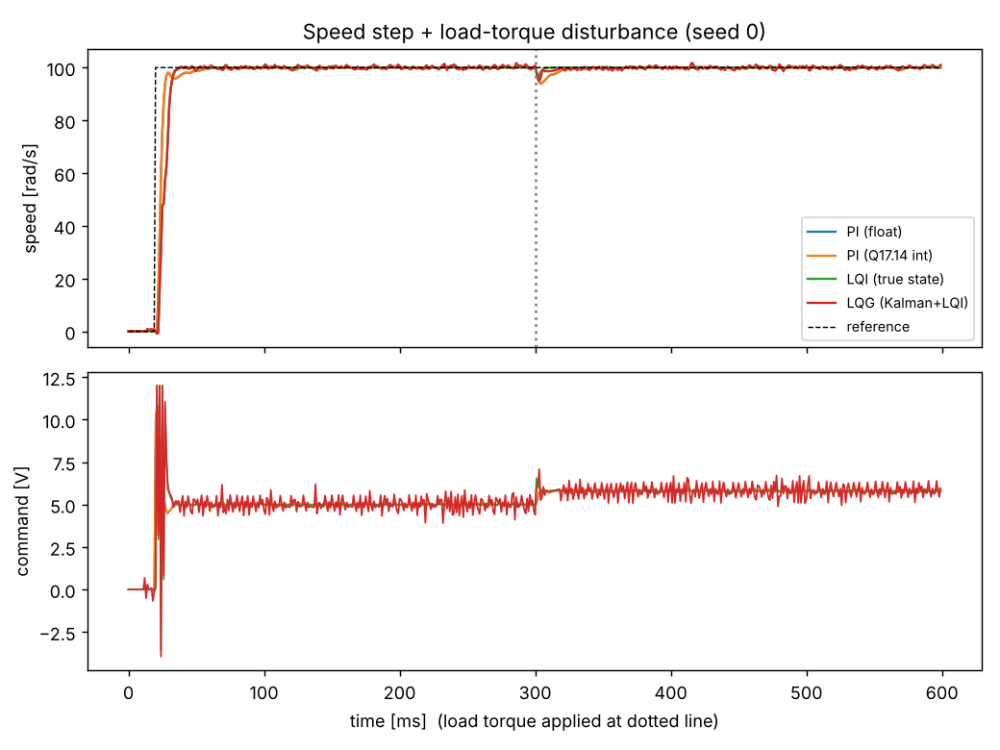
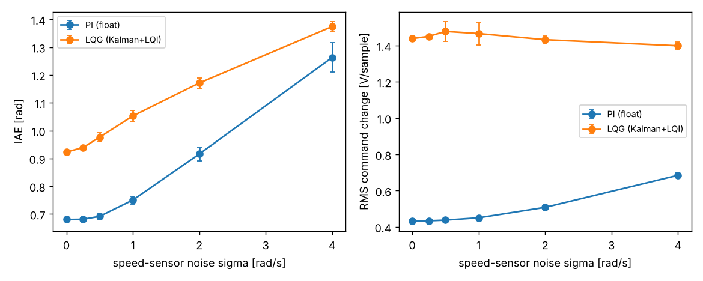
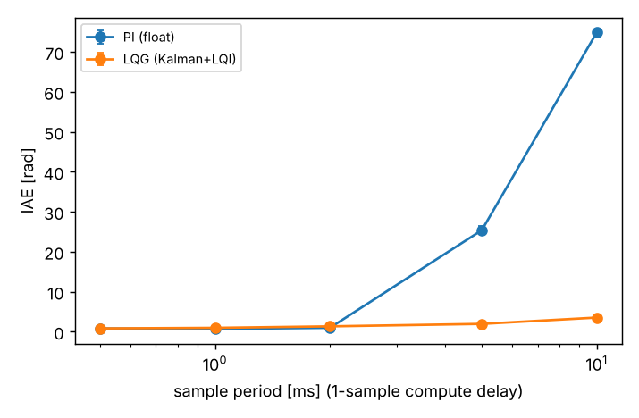
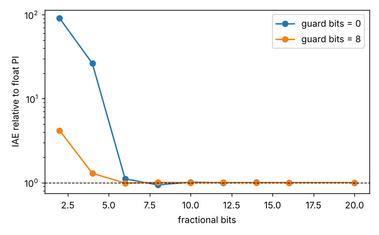
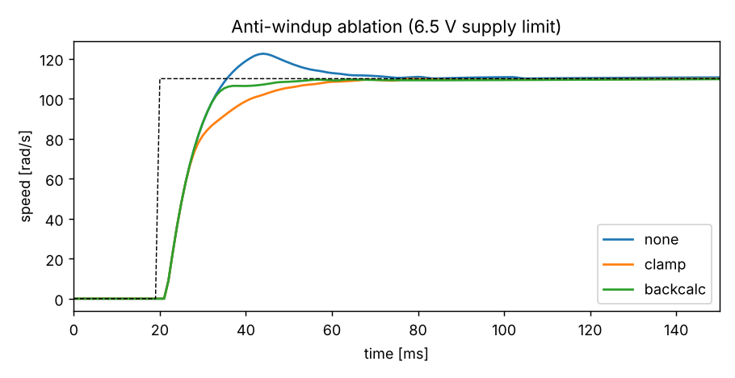

# DC-motor speed-control lab: PI, integer PI, LQI and LQG

A from-scratch, tested control-engineering pipeline for an armature-controlled brushed DC motor, the
workhorse actuator of small robots. It compares four speed controllers under the non-idealities that
actually bite on an embedded target: a quantised encoder, sensor noise, a voltage limit, a one-sample
compute delay, a load-torque disturbance, a slow sample rate and a limited word length.

* **PI (float)**: positional PI with clamp anti-windup, gains found by grid search.
* **PI (Q17.14 int)**: the same algorithm in pure integer arithmetic (saturating Q-format, guard bits on the integrator).
* **LQI (true state)**: LQR with integral action on the full state, the "ideal" reference.
* **LQG**: steady-state Kalman filter (current, speed, load torque) + delay-aware LQI + torque feed-forward.

Everything numeric is implemented here (matrix exponential, ZOH discretisation, Riccati solver, Kalman
filter, fixed-point arithmetic) and validated against SciPy or closed forms. Every number below was
produced by `python -m motorctl.cli run --out results --seeds 20`, which takes about 6 s.

## ECE concepts

Electrical and mechanical dynamics of the motor (state `x = [i, w]`, input `V`, disturbance `tau`):

```
L di/dt = V - R i - Ke w          J dw/dt = Kt i - b w - tau
```

Parameters: R = 2 ohm, L = 1 mH, Kt = Ke = 0.05, J = 1e-5 kg m^2, b = 2e-6, supply limit 12 V. The
electrical pole is at R/L = 2000 rad/s (0.5 ms) and the mechanical time constant is about 8 ms, so a
1 kHz loop sees a stiff two-time-scale plant. Steady state: `w = (Kt V - R tau) / (Kt Ke + R b)`.

Exact zero-order-hold discretisation uses one matrix exponential of the block matrix `[[A B],[0 0]] Ts`.
LQI augments the plant with the error integral `z+ = z + Ts (r - w)` and solves
`P = A'PA - A'PB (R + B'PB)^-1 B'PA + Q`, `K = (R + B'PB)^-1 B'PA`, `u = -Kx x - Kz z`.
The Kalman filter uses the dual DARE and a random-walk load-torque state `d`, which also provides a
feed-forward term `u_ff = -N d_hat` with `N = (C M Bdist)/(C M Bv)`, `M = (I - Ad + Bv Kx)^-1`.
One sample of compute delay is absorbed exactly by appending the pending command to the state.

Fixed point: a value `x` is stored as `round(x 2^f)` in a saturating two's-complement word. The integral
increment `ki Ts e` is tiny, so without extra "guard" fractional bits on the accumulator it underflows
(Results, section "Fixed point").

## Architecture (pyramid)



| Layer | Modules | Role |
|---|---|---|
| 0 | `plant`, `fixedpoint`, `metrics`, `riccati` | motor model + ZOH, Q-format arithmetic, step/disturbance metrics, doubling DARE solver |
| 1 | `controllers`, `estimators` | PID with anti-windup, LQI design, time-varying and steady-state Kalman filters |
| 2 | `fixedpid`, `lqg` | integer PI, LQG controller with delay-aware state |
| 3 | `simulate`, `factory` | closed-loop sim (encoder, noise, saturation, delay) and controller builder |
| 4 | `experiments` | tuning, 20-seed comparison with CIs, sweeps, ablations, figures, validation |
| apex (5) | `cli` | `run`, `validate`, `tune`, `simulate` |

`tests/test_pyramid.py` parses every module with `ast`, checks that imports only point to strictly lower
layers, and that the apex (`cli`) transitively depends on every other module.

## How to run

```bash
pip install -r requirements.txt
python -m pytest -q                         # 59 tests, ~2 s
python -m motorctl.cli run --out results    # full pipeline (--quick for a smoke run)
python -m motorctl.cli validate             # kernels vs SciPy / closed forms
python -m motorctl.cli simulate --kind lqg --sigma 1.0 --cpr 1000 --ts 0.002
```

## Validation against references

| Check | Reference | Measured agreement |
|---|---|---|
| Matrix exponential (5 random 4x4 + motor) | `scipy.linalg.expm` | max relative error 3.5e-14 |
| ZOH discretisation, Ts in {0.2, 1, 5} ms | `scipy.signal.cont2discrete` | max abs error 6.1e-12 |
| DARE, 6 random 3-state systems | `scipy.linalg.solve_discrete_are` | max relative error 1.4e-12 |
| Scalar DARE A=B=Q=R=1 | closed form (1+sqrt 5)/2 | abs error 0 |
| Kalman prior covariance (steady state) | `solve_discrete_are` on the dual | relative error 2e-16 |
| Recursive KF covariance after 4000 steps | steady-state DARE | relative error 4e-16 |
| Rise time of 1st-order response | 2.197 tau (analytic) | within 1 % (unit test) |
| Overshoot of 2nd-order response, zeta = 0.5 | exp(-pi z/sqrt(1-z^2)) = 16.3 % | within 1 % (unit test) |
| DC gains | closed-form `Kt/(R b + Kt Ke)` | 1e-6 relative after 3000 simulated steps |

## Results

Setup: 100 rad/s step at 20 ms, 0.02 N m load torque at 300 ms, 1 kHz, 4000-count encoder (1.57 rad/s
speed resolution), Gaussian speed noise sigma = 0.5 rad/s, 1-sample compute delay. PI gains from a 5x5
grid search (kp = 0.1, ki = 10). Mean +/- 95 % CI over 20 seeds.



| Controller | IAE [rad] | Overshoot [%] | Settle 5 % [ms] | Load dip [rad/s] | Recover [ms] | RMS du [V] |
|---|---|---|---|---|---|---|
| PI (float) | 0.693 +/- 0.005 | 0.72 +/- 0.05 | 8.0 | 5.80 +/- 0.13 | 7.7 +/- 0.4 | 0.437 |
| PI (Q17.14 int) | 0.693 +/- 0.005 | 0.72 +/- 0.05 | 8.0 | 5.80 +/- 0.13 | 7.7 +/- 0.4 | 0.437 |
| LQI (true state) | 0.715 | 0.00 | 13.0 | 3.70 | 0.0 | 1.319 |
| LQG | 0.976 +/- 0.008 | 1.52 +/- 0.10 | 12.8 +/- 0.2 | 4.13 +/- 0.24 | 0.4 +/- 0.6 | 1.465 +/- 0.020 |

Reading it honestly: on a plant this benign, a well-tuned PI wins on tracking error (IAE) and uses far
less actuator activity; LQI/LQG win on the load-torque dip (about 29 % smaller for LQG) and have no
overshoot in the oracle case. The LQG gives up about 41 % IAE versus the PI here, so the estimator does cost
something (the oracle LQI is 0.715), and the high state-feedback gain on speed makes it pass sensor noise
to the bridge (RMS du about 3.4x the PI's).

### Noise sweep



| sigma [rad/s] | PI IAE | LQG IAE | PI RMS du | LQG RMS du |
|---|---|---|---|---|
| 0 | 0.681 | 0.923 | 0.431 | 1.439 |
| 0.5 | 0.692 +/- 0.010 | 0.976 +/- 0.016 | 0.438 | 1.479 |
| 1 | 0.750 +/- 0.014 | 1.053 +/- 0.019 | 0.450 | 1.467 |
| 2 | 0.916 +/- 0.025 | 1.171 +/- 0.018 | 0.508 | 1.433 |
| 4 | 1.263 +/- 0.053 | 1.374 +/- 0.018 | 0.685 | 1.399 |

The LQG degrades more slowly with noise (its IAE grows 49 % from sigma 0 to 4 versus 85 % for the PI), and
the gap in IAE shrinks from 0.24 to 0.11, but it does not overtake the PI inside this range.

### Sample-rate sweep (same PI gains, LQG re-designed per Ts)



| Ts [ms] | PI IAE | LQG IAE | PI dip | LQG dip |
|---|---|---|---|---|
| 0.5 | 0.835 | 0.834 | 5.11 | 3.53 |
| 1 | 0.692 | 0.976 | 5.73 | 4.20 |
| 2 | 0.986 | 1.347 | 7.50 | 6.54 |
| 5 | 25.4 +/- 1.0 | 1.958 | 58.5 | 11.85 |
| 10 | 74.9 | 3.542 | 307.6 | 14.77 |

This is the clearest practical result. The PI gains were tuned at 1 ms and **not** re-tuned; at 5 and 10 ms
the loop with one-sample delay is unstable (the load dip of 307 rad/s at 10 ms is a sustained
oscillation). The LQG remains stable because its gains are recomputed for each Ts and the delay is in the
design model. A fairer PI comparison would re-tune per Ts (not done; see limitations).

### Fixed point



Float PI IAE = 0.689 (4 seeds). Word length 32 bits.

| Fractional bits | ki*Ts realised (guard 0) | IAE / float (guard 0) | IAE / float (guard 8) |
|---|---|---|---|
| 2 | 0.000000 | 90.9 | 4.18 |
| 4 | 0.000000 | 26.3 | 1.29 |
| 6 | 0.015625 | 1.11 | 0.99 |
| 8 | 0.011719 | 0.94 | 1.01 |
| 10 | 0.009766 | 1.02 | 1.00 |
| 12 | 0.010010 | 1.00 | 1.00 |
| 16 | 0.009995 | 1.00 | 1.00 |

Designed `ki Ts` = 0.01. With 2 or 4 fractional bits the integral gain rounds to **zero** (integral action
silently disappears and a steady-state error remains, hence IAE 26x to 91x worse). Eight guard bits on the accumulator remove
the problem: with guard bits the integer PI is within 1 % of float from 6 fractional bits upward, versus
needing about 10 bits without them. Gains are quantised at design time, so the realised gain error is a
design-time property worth checking in firmware (`effective_ki_ts`).

### Anti-windup ablation (6.5 V limit, 110 rad/s step)



| Mode | IAE | Overshoot [%] | Settle [ms] |
|---|---|---|---|
| none | 1.198 | 11.3 | 34 |
| clamp | 1.238 | 0.7 | 28 |
| back-calculation | 1.052 | 0.7 | 15 |

Without anti-windup the integrator charges during the saturated start and overshoots by 11 %. Clamping
cures the overshoot but is slow to settle; back-calculation is best on both counts here (single run,
deterministic, noise-free).

### LQG ablation (8 seeds)

| Variant | IAE | Load dip | Recover [ms] |
|---|---|---|---|
| LQG (full) | 0.976 +/- 0.016 | 4.20 +/- 0.49 | 1.0 +/- 1.5 |
| LQG without torque feed-forward | 0.968 +/- 0.009 | 4.19 +/- 0.26 | 0.0 |
| LQI with true state | 0.715 | 3.70 | 0.0 |

The estimated-torque feed-forward does **not** measurably help: the CIs overlap completely. With a
load step of 0.02 N m and a fast integrator the Kalman torque state converges too late to matter. Most of
the LQG loss comes from state estimation (0.976 vs 0.715), not from the missing feed-forward.

## Failure cases

* PI gains tuned at 1 kHz fail at 200 Hz and 100 Hz with a one-sample delay (table above).
* At 2-4 fractional bits the integer PI loses its integral term entirely.
* LQG actuator activity is 3.4x the PI's at nominal noise; an actuator with limited slew rate or a noisy
  H-bridge would want a lower speed weight or a command low-pass filter.
* Without anti-windup a saturated start overshoots by 11 %.

## Limitations and threats to validity

* Simulation only, one motor parameter set, no parameter mismatch between design and plant model, so
  robustness (gain/phase margin, J or R uncertainty) is not assessed.
* The PI is tuned by a coarse grid and not re-tuned per sample period; the PI-vs-LQG verdict at slow rates
  is therefore partly a tuning artefact.
* LQR weights (`q_w = 1`, `q_int = 3e5`) were chosen with a small manual scan on the oracle LQI, not optimised.
* Encoder quantisation is modelled as rounding of the noisy speed; real count-difference encoders also have
  edge-timing effects, cogging and non-white noise.
* Only 8 seeds for sweeps (4 for fixed point) and 20 for the headline table; CIs are Student-t on seed means.
* The fixed-point model uses Python integers (exact), so it validates arithmetic design, not a specific MCU's
  overflow or timing behaviour.

## Future work

Add robust-margin analysis, re-tune the PI at every sample rate, add a command filter to LQG, model
current-loop PWM dynamics, and port the integer PI to a C fixed-point kernel with a cycle-count model.

## Layout

```
motorctl/   plant fixedpoint metrics riccati | controllers estimators | fixedpid lqg | simulate factory | experiments | cli
tests/      59 tests incl. test_reference.py (SciPy ground truth) and test_pyramid.py (ast layer check)
results/    figures, results.md, summary.json (regenerated by `cli run`)
```
