# Low-light sensor-to-inference lab

**How many photons does a tiny camera need before a classifier works, and is it worth spending ISP compute to denoise first?**
This project builds a physical image-sensor simulator (photon shot noise, dark current, read noise, fixed-pattern gain, ADC quantisation), seven pluggable denoisers, from-scratch classifiers (including an integer-only int8 MLP) and a deployment cost model, then measures accuracy against exposure with multiple seeds, paired confidence intervals, ablations and a failure analysis. Everything in this README was produced by running the code in this folder; the numbers in the tables are copied from `results/tables.md`.

> Flagship project, built as a layered "pyramid" (see [Architecture](#architecture-the-pyramid)). 126 tests, 1819 lines of package code, 868 lines of tests, full run in about 4.8 minutes.

## Key findings (all from the runs below)

1. **Denoising only buys accuracy in the photon-starved regime.** At 2 and 5 peak electrons the learned linear filter (`ridge`) beats doing nothing by +9.7 ± 4.4 and +5.1 ± 2.7 percentage points (paired 95% CI over 5 seeds). From 20 e- upward no denoiser is significantly better than the identity ISP, and a few are slightly worse (median at 20 e-, box at 100 and 300 e-).
2. **Pixel fidelity is the wrong objective.** PSNR improves with denoising at every exposure (for example 16.66 → 22.71 dB at 20 e- with `ridge`) while accuracy does not move. The PSNR winner and the accuracy winner disagree at six of the eight exposures.
3. **Read noise, not ADC depth, is the lever at low light.** With 20 e- peak signal, raising read noise from 2 to 16 e- drops identity-ISP accuracy from 94.8% to 60.6%; `ridge` recovers part of it (71.0%). Meanwhile 3 to 12 ADC bits are indistinguishable within the confidence intervals, and 2 bits costs about 1.5 points at 20 e-.
4. **Integer inference is free here.** The int8 post-training-quantised MLP matches the float MLP at all three exposures tested and uses a quarter of the weight bytes; int4 loses at most about 0.5 points.
5. **No claimed per-method improvement at 20+ e- survives multiple-comparison control.** With 42 paired comparisons and 5 seeds, no cell passes Holm-Bonferroni, so this note treats single-cell "significant" marks as exploratory.

## Problem and real-world relevance

Battery-powered vision nodes (doorbell cameras, wildlife traps, wearable cameras, industrial inspection heads) run in dim light with small pixels, short exposures and a microcontroller-class budget. Two design questions come up repeatedly:

* *Exposure/gain/ADC:* how few photo-electrons and how few ADC bits can the application tolerate? ADC energy roughly doubles per extra bit, and longer exposure costs latency and motion blur.
* *ISP compute:* is a denoising stage in front of the classifier worth its multiply-accumulates, line buffers and energy, or should the (cheap) classifier simply be trained on the noisy data?

The lab answers those questions for a concrete, fully reproducible task (10-class digit recognition on a real public dataset) with a sensor model whose statistics are checked against theory (photon-transfer curve, Fano factor, quantisation noise). The numbers are specific to this task and sensor model, but the *method* (sweep exposure, pair seeds, compare against an identity ISP, price the compute) transfers directly to a real camera if you replace the simulator by raw captures.

## Related approaches

* **Poisson-Gaussian raw-image noise model.** Healey & Kondepudy (IEEE TPAMI 1994) and Foi et al. (IEEE TIP 2008) model raw sensor noise as signal-dependent shot noise plus signal-independent read noise; the EMVA 1288 standard defines the photon-transfer measurement used in `ptc.py`.
* **Variance-stabilising transforms.** Anscombe (Biometrika 1948) introduced the square-root transform for Poisson data; Mäkitalo & Foi (IEEE TIP 2013) give the generalised transform for Poisson-Gaussian noise and its exact/asymptotic inverses, implemented here in `GATGaussian`.
* **Adaptive Wiener filtering.** Lim, *Two-Dimensional Signal and Image Processing* (Prentice Hall, 1990) describes the local-statistics Wiener filter reproduced in `imgops.wiener_filter`.
* **Energy of arithmetic.** Horowitz (ISSCC 2014) tabulates 45 nm energy per arithmetic operation; `budget.py` uses order-of-magnitude constants in that spirit and flags them as assumptions.
* **Data.** The scene source is the UCI "Optical Recognition of Handwritten Digits" test set (Alpaydin & Kaynak), shipped with scikit-learn as `load_digits`.

## Method

### Sensor model (`sensor.py`)

For radiance `r ∈ [0,1]` at pixel `(i,j)`, with peak signal `N` electrons, PRNU gain `g_ij = 1 + σ_g ε_ij` (fixed per sensor), dark electrons `D`, read noise `σ_r`:

```
λ_ij  = g_ij · N · r_ij + D
e_ij  = Poisson(λ_ij) + 𝒩(0, σ_r²)
code  = round( clip(e + B, 0, FS) / FS · (2^b − 1) ),   B = 3σ_r,  FS = B + D + headroom·N·max(g)
r̂_ij  = ( code·FS/(2^b−1) − B − D ) / (N · g_ij)          (calibrated black level and flat-field)
```

The reconstruction is unbiased at high light. Its variance in radiance units is `(N r + D + σ_r² + Δ²/12) / N²`, with `Δ = FS/(2^b−1)` the ADC step. `Sensor.noise_var_radiance` implements this and the tests compare it with the empirical variance.

### Denoisers (`denoisers.py`, registry `DENOISERS`)

| name | idea | per-pixel ops (descriptor) | line-buffer rows |
|---|---|---|---|
| `identity` | no ISP (baseline) | 0 | 0 |
| `box` | 3×3 mean | 2k | 2 |
| `gaussian` | separable Gaussian, σ picked on training data from {0.4…1.7} | 2·taps | taps−1 |
| `median` | 3×3 median | k²⌈log₂k²⌉ comparator-equivalents | 2 |
| `wiener` | local Wiener, *signal-dependent* noise variance from the sensor model | 2k²+10 | 4 |
| `gat` | generalised Anscombe `2√(z+3/8+σ²)` → Gaussian → inverse (algebraic or asymptotic) | 2·taps+14 | 2r |
| `ridge` | learned 5×5 shift-invariant linear filter, closed-form ridge regression | 25 | 4 |

The asymptotic inverse of the transform used is `D²/4 + ¼√(3/2)·D⁻¹ − 11/8·D⁻² + 5/8·√(3/2)·D⁻³ − 1/8 − σ²`.

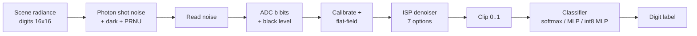

### Classifiers (`classifiers.py`)

`SoftmaxRegression` (L-BFGS, analytic gradient checked numerically), a one-hidden-layer `MLP` (64 ReLU units, Adam) and `QuantizedMLP`, which converts a trained MLP to int8 weights/activations with int32 accumulators and per-layer requantisation (a real integer data path: `fixedpoint.int_matmul` raises on accumulator overflow). The headline sweep uses softmax regression so that 600+ trials fit in minutes; the MLP and int8/int4 variants are compared in a separate study.

### Training protocol (`pipeline.py`)

* *matched* (default): the classifier is trained on denoised captures at the deployment exposure (two noise realisations per training scene).
* *clean*: the classifier is trained on ideal images and meets noise only at test time.

All methods see **identical noisy test images** for a given seed (noise streams are seeded by `(seed, split)`), so differences between methods are paired.

## Architecture: the pyramid

Every module imports only from strictly lower layers; `tests/test_pyramid.py` verifies this with `ast`, verifies there are no cycles, and verifies that the apex (`cli`) transitively depends on every other module.

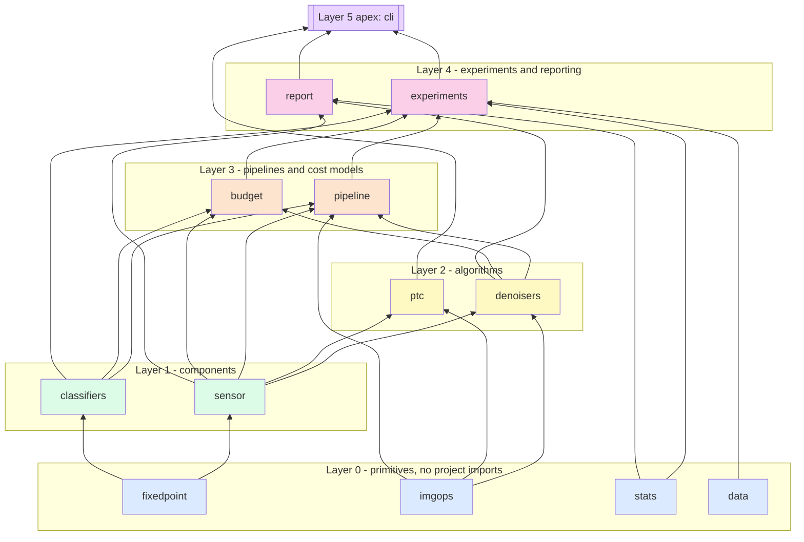

| Layer | Modules | Role | Tested by |
|---|---|---|---|
| 0 | `fixedpoint`, `imgops`, `stats`, `data` | quantisers/Q-format, batched filters and SSIM/PSNR, t-intervals and Holm correction, digits + splits | `test_l0.py`, `test_reference.py` |
| 1 | `sensor`, `classifiers` | Poisson-Gaussian sensor with ADC; softmax/MLP/int8 MLP | `test_l1.py`, `test_reference.py` |
| 2 | `denoisers`, `ptc` | seven ISP denoisers; photon-transfer characterisation | `test_l2.py`, `test_ptc.py`, `test_reference.py` |
| 3 | `pipeline`, `budget` | train/evaluate protocol; MACs, SRAM, energy, latency | `test_l3.py` |
| 4 | `experiments`, `report` | config-driven runner, aggregation, failure analysis; figures and tables | `test_l4.py` |
| 5 (apex) | `cli` | `run`, `report`, `budget`, `ptc`, `demo` | `test_l4.py`, `test_pyramid.py` |

| module | lines |
|---|---|
| `budget` | 70 |
| `classifiers` | 196 |
| `cli` | 131 |
| `data` | 28 |
| `denoisers` | 267 |
| `experiments` | 278 |
| `fixedpoint` | 103 |
| `imgops` | 141 |
| `pipeline` | 105 |
| `ptc` | 84 |
| `report` | 223 |
| `sensor` | 112 |
| `stats` | 63 |
| **package total** (incl. `__init__`, `__main__`) | **1819** |

## Experimental setup

* **Data:** 1797 handwritten digits (8×8, 16 grey levels) bilinearly upsampled to 16×16 and treated as scene radiance. Per seed a stratified 75/25 split gives 1347 training and 450 test scenes (one test image = 0.22 points). The seed also changes the noise realisation, the sensor fixed pattern and the classifier initialisation.
* **Sensor:** peak signal swept over {2, 5, 10, 20, 50, 100, 300, 1000} electrons; read noise 2 e-, dark 1 e-, PRNU 1%, 10-bit ADC, headroom 1.2 (unless a sweep varies them).
* **Seeds:** 5 for the headline sweep and ablations, 3 for the ADC, read-noise and classifier sweeps. Intervals are Student-t 95% intervals over seeds (`stats.mean_ci`); comparisons against the identity ISP are paired by seed (`stats.paired_diff_ci`). Because the seeds also resample the 450-image test split, the intervals include test-set sampling variance.
* **Config:** everything is in `configs/default.json` (also embedded as `lowlight/default_config.json`); the resolved config of each run is saved to `results/config_resolved.json`.
* **Total:** 619 train/evaluate trials, 4.8 minutes on 2 CPU workers.

## Validation against references

The base and middle layers are compared with independent implementations in `tests/test_reference.py`. Agreement numbers below were measured by running those comparisons.

| Component | Reference | Measured agreement |
|---|---|---|
| Gaussian filter (σ = 0.7, 1.5; reflect) | `scipy.ndimage.gaussian_filter` | max abs error 3.3e-16 |
| 3×3 median filter | `scipy.ndimage.median_filter` | max abs error 0 |
| 5×5 box filter | `scipy.ndimage.uniform_filter` | max abs error 4.4e-16 |
| Local Wiener filter (scalar noise and noise=None) | `scipy.signal.wiener` | max abs error 1.3e-15 |
| SSIM (7×7 uniform window) | `skimage.metrics.structural_similarity` | max abs error 4.4e-16 |
| PSNR | `skimage.metrics.peak_signal_noise_ratio` | max abs error 0 |
| Softmax regression | `sklearn.linear_model.LogisticRegression` (matched regularisation) | max abs probability difference 3.0e-4; identical predictions on 900 digits |
| Ridge patch filter | `sklearn.linear_model.Ridge` | max abs weight error 8.2e-16, intercept 1.6e-15 |
| Shot noise | Poisson theory (variance/mean = 1) | Fano factor 0.9998 |
| Generalised Anscombe | unit-variance stabilisation | variance 1.007, 0.992, 0.994 at λ = 10, 50, 200 (raw variance 14.0, 53.6, 202.8) |
| ADC quantisation noise | Δ²/12 | measured/theory = 1.0002 |
| Photon transfer curve | configured ADC gain and noise floor | see [PTC](#sensor-characterisation-from-flat-fields-only) |
| Softmax gradient | numeric gradient (`scipy.optimize.check_grad`) | error < 1e-5 (test threshold) |
| Clean 16×16 digits, softmax | sanity check only (no published value is claimed) | 96.7% test accuracy |

## Results

### Accuracy versus exposure

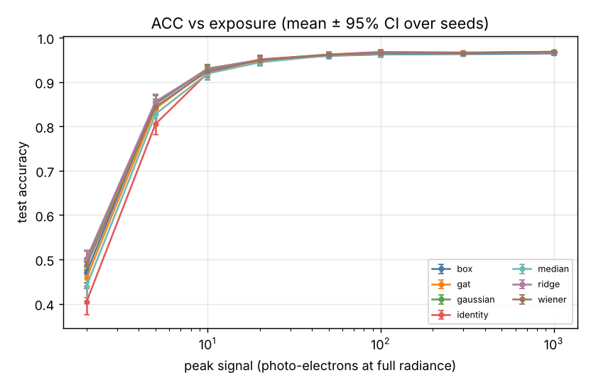

Test accuracy %, mean ± 95% CI over 5 seeds:

| e- (peak) | identity | box | gaussian | median | wiener | gat | ridge |
|---|---|---|---|---|---|---|---|
| 2 | 40.5 ± 3.0 | 47.1 ± 2.3 | 49.8 ± 2.2 | 44.0 ± 2.6 | 48.7 ± 1.7 | 45.8 ± 1.9 | 50.2 ± 1.9 |
| 5 | 80.5 ± 2.5 | 85.1 ± 2.2 | 85.4 ± 1.5 | 82.8 ± 0.9 | 84.4 ± 1.6 | 84.0 ± 1.6 | 85.6 ± 1.7 |
| 10 | 92.0 ± 1.5 | 93.0 ± 0.9 | 93.0 ± 1.0 | 91.9 ± 1.4 | 92.4 ± 1.4 | 92.8 ± 1.1 | 92.9 ± 1.0 |
| 20 | 95.1 ± 0.7 | 95.0 ± 0.8 | 94.9 ± 0.9 | 94.4 ± 0.8 | 94.9 ± 1.1 | 94.7 ± 1.1 | 95.0 ± 0.9 |
| 50 | 96.2 ± 0.3 | 95.9 ± 0.4 | 96.1 ± 0.5 | 96.0 ± 0.8 | 96.1 ± 0.6 | 96.1 ± 0.6 | 96.2 ± 0.5 |
| 100 | 96.8 ± 0.4 | 96.2 ± 0.5 | 96.5 ± 0.7 | 96.3 ± 0.7 | 96.5 ± 0.7 | 96.5 ± 0.7 | 96.7 ± 0.6 |
| 300 | 96.7 ± 0.2 | 96.3 ± 0.5 | 96.6 ± 0.3 | 96.5 ± 0.3 | 96.6 ± 0.3 | 96.5 ± 0.5 | 96.5 ± 0.2 |
| 1000 | 96.8 ± 0.4 | 96.4 ± 0.3 | 96.8 ± 0.3 | 96.6 ± 0.4 | 96.8 ± 0.4 | 96.8 ± 0.3 | 96.8 ± 0.2 |

PSNR (dB) of the denoised image against the clean scene:

| e- (peak) | identity | box | gaussian | median | wiener | gat | ridge |
|---|---|---|---|---|---|---|---|
| 2 | 6.15 ± 0.01 | 10.22 ± 0.04 | 10.98 ± 0.04 | 8.78 ± 0.04 | 10.88 ± 0.05 | 11.02 ± 0.05 | 11.80 ± 0.04 |
| 5 | 9.24 ± 0.02 | 15.30 ± 0.03 | 15.89 ± 0.04 | 13.82 ± 0.03 | 15.04 ± 0.04 | 15.78 ± 0.04 | 16.21 ± 0.04 |
| 10 | 12.88 ± 0.01 | 19.10 ± 0.03 | 19.20 ± 0.03 | 17.59 ± 0.03 | 17.03 ± 0.04 | 19.09 ± 0.03 | 19.72 ± 0.05 |
| 20 | 16.66 ± 0.03 | 21.70 ± 0.02 | 21.97 ± 0.03 | 20.40 ± 0.00 | 18.93 ± 0.01 | 21.94 ± 0.04 | 22.71 ± 0.03 |
| 50 | 21.42 ± 0.03 | 23.55 ± 0.03 | 25.15 ± 0.03 | 23.13 ± 0.04 | 22.33 ± 0.03 | 25.20 ± 0.04 | 26.50 ± 0.05 |
| 100 | 24.71 ± 0.04 | 24.13 ± 0.02 | 27.16 ± 0.03 | 24.57 ± 0.03 | 25.17 ± 0.04 | 27.24 ± 0.03 | 29.04 ± 0.05 |
| 300 | 29.70 ± 0.04 | 24.49 ± 0.02 | 30.70 ± 0.03 | 26.02 ± 0.02 | 29.85 ± 0.03 | 30.75 ± 0.03 | 32.86 ± 0.04 |
| 1000 | 34.97 ± 0.03 | 24.61 ± 0.01 | 35.36 ± 0.04 | 26.79 ± 0.03 | 35.01 ± 0.03 | 35.40 ± 0.04 | 36.45 ± 0.04 |

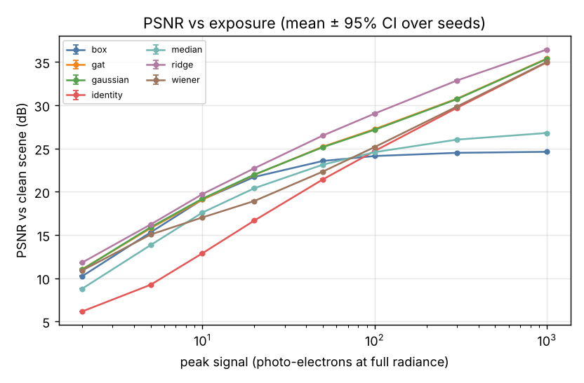

Paired accuracy difference to the identity ISP in percentage points (`*` = paired 95% CI excludes zero, uncorrected; `†` = survives Holm-Bonferroni over all 42 comparisons):

| e- (peak) | box | gaussian | median | wiener | gat | ridge |
|---|---|---|---|---|---|---|
| 2 | 6.6 ± 2.3* | 9.3 ± 3.7* | 3.5 ± 2.3* | 8.2 ± 3.2* | 5.3 ± 4.6* | 9.7 ± 4.4* |
| 5 | 4.6 ± 2.3* | 4.8 ± 3.0* | 2.3 ± 2.2* | 3.9 ± 3.3* | 3.5 ± 2.3* | 5.1 ± 2.7* |
| 10 | 1.0 ± 1.1 | 1.0 ± 0.9* | -0.1 ± 1.2 | 0.4 ± 0.8 | 0.7 ± 1.0 | 0.8 ± 1.3 |
| 20 | -0.1 ± 0.5 | -0.2 ± 0.5 | -0.7 ± 0.4* | -0.2 ± 0.6 | -0.4 ± 0.6 | -0.1 ± 0.5 |
| 50 | -0.3 ± 0.3 | -0.1 ± 0.3 | -0.2 ± 0.6 | -0.1 ± 0.4 | -0.1 ± 0.4 | -0.0 ± 0.2 |
| 100 | -0.6 ± 0.4* | -0.3 ± 0.4 | -0.5 ± 0.4* | -0.3 ± 0.4 | -0.3 ± 0.4 | -0.1 ± 0.3 |
| 300 | -0.4 ± 0.3* | -0.1 ± 0.2 | -0.1 ± 0.4 | -0.1 ± 0.2 | -0.2 ± 0.4 | -0.2 ± 0.1* |
| 1000 | -0.4 ± 0.4 | 0.0 ± 0.1 | -0.2 ± 0.5 | 0.0 ± 0.0 | 0.0 ± 0.1 | 0.0 ± 0.2 |

Reading the tables: at 2 and 5 e- every denoiser helps (all six CIs exclude zero) and `ridge` and `gaussian` lead. At 10 e- only `gaussian` is nominally significant (+1.0 ± 0.9). Beyond 20 e- the identity ISP is as good as anything, and slightly better than `box`/`median` where those blur away stroke detail. No cell carries `†`: with five seeds and 42 comparisons the study is under-powered for effects smaller than a few points, so the low-light gains are best read as consistent in size and sign rather than formally corrected-significant.

Sample captures (columns: clean, identity, gaussian, gat, ridge; rows: 2, 5, 20, 100 e-):

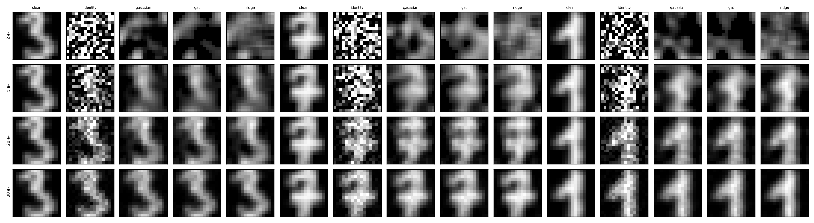

### Ablations

**Training mode.** Does the classifier need to see noisy data?

| train mode | e- | denoiser | accuracy % |
|---|---|---|---|
| clean | 5 | gat | 77.7 ± 2.1 |
| clean | 5 | gaussian | 77.8 ± 2.4 |
| clean | 5 | identity | 78.6 ± 1.5 |
| clean | 5 | ridge | 80.8 ± 1.9 |
| clean | 20 | gat | 94.5 ± 1.2 |
| clean | 20 | gaussian | 94.6 ± 1.0 |
| clean | 20 | identity | 95.4 ± 1.1 |
| clean | 20 | ridge | 94.7 ± 1.0 |
| clean | 100 | gat | 96.4 ± 0.7 |
| clean | 100 | gaussian | 96.7 ± 0.5 |
| clean | 100 | identity | 96.8 ± 0.6 |
| clean | 100 | ridge | 96.7 ± 0.4 |
| matched | 5 | gat | 84.0 ± 1.6 |
| matched | 5 | gaussian | 85.4 ± 1.5 |
| matched | 5 | identity | 80.5 ± 2.5 |
| matched | 5 | ridge | 85.6 ± 1.7 |
| matched | 20 | gat | 94.7 ± 1.1 |
| matched | 20 | gaussian | 94.9 ± 0.9 |
| matched | 20 | identity | 95.1 ± 0.7 |
| matched | 20 | ridge | 95.0 ± 0.9 |
| matched | 100 | gat | 96.5 ± 0.7 |
| matched | 100 | gaussian | 96.5 ± 0.7 |
| matched | 100 | identity | 96.8 ± 0.4 |
| matched | 100 | ridge | 96.7 ± 0.6 |

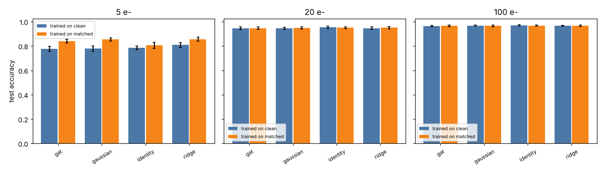

At 5 e- the best combination (denoise + matched training: `ridge`, 85.6%) is about 7 points above the camera-unaware baseline (identity ISP, trained on clean images, 78.6%). Roughly 2 points of that come from matched training alone (80.5% vs 78.6%, within the CIs) and the rest from the denoiser. At 20 and 100 e- the training mode makes no measurable difference.

**Variance stabilisation.** Is the Anscombe transform worth it?

| variant | e- | acc % | PSNR dB |
|---|---|---|---|
| gaussian (no VST) | 5 | 85.4 ± 1.5 | 15.89 ± 0.04 |
| gaussian (no VST) | 20 | 94.9 ± 0.9 | 21.97 ± 0.03 |
| gaussian (no VST) | 100 | 96.5 ± 0.7 | 27.16 ± 0.03 |
| gat + algebraic inverse | 5 | 84.3 ± 1.1 | 15.29 ± 0.05 |
| gat + algebraic inverse | 20 | 94.7 ± 1.2 | 21.81 ± 0.04 |
| gat + algebraic inverse | 100 | 96.6 ± 0.6 | 27.15 ± 0.03 |
| gat + asymptotic inverse | 5 | 84.0 ± 1.6 | 15.78 ± 0.04 |
| gat + asymptotic inverse | 20 | 94.7 ± 1.1 | 21.94 ± 0.04 |
| gat + asymptotic inverse | 100 | 96.5 ± 0.7 | 27.24 ± 0.03 |

In this setup the transform did **not** beat a plain Gaussian filter (84.0 vs 85.4% at 5 e-, CIs overlap). The asymptotic inverse recovers 0.5 dB PSNR over the algebraic inverse at 5 e- (15.78 vs 15.29 dB), consistent with its purpose, but the accuracy difference is inside the noise. We did not run an experiment isolating why the VST adds little here (candidates: tiny 16×16 images where the Gaussian σ is chosen on training data, and a classifier trained on the denoiser output that can absorb bias).

**Patch size of the learned filter.**

| e- | patch | acc % | PSNR dB |
|---|---|---|---|
| 5 | 3x3 | 85.2 ± 2.1 | 15.12 ± 0.02 |
| 5 | 5x5 | 85.6 ± 1.7 | 16.21 ± 0.04 |
| 5 | 7x7 | 85.6 ± 1.7 | 16.33 ± 0.04 |
| 5 | 9x9 | 85.6 ± 1.4 | 16.43 ± 0.04 |
| 20 | 3x3 | 95.0 ± 0.9 | 22.54 ± 0.03 |
| 20 | 5x5 | 95.0 ± 0.9 | 22.71 ± 0.03 |
| 20 | 7x7 | 95.1 ± 1.0 | 22.82 ± 0.03 |
| 20 | 9x9 | 95.1 ± 1.0 | 22.87 ± 0.03 |
| 100 | 3x3 | 96.7 ± 0.4 | 28.22 ± 0.05 |
| 100 | 5x5 | 96.7 ± 0.6 | 29.04 ± 0.05 |
| 100 | 7x7 | 96.8 ± 0.6 | 29.12 ± 0.05 |
| 100 | 9x9 | 96.9 ± 0.6 | 29.15 ± 0.05 |

PSNR rises monotonically with patch size (15.12 → 16.43 dB at 5 e- from 3×3 to 9×9) while accuracy is flat within the CIs. The 5×5 filter (25 MACs/pixel) captures most of the benefit that a 9×9 filter (81 MACs/pixel) offers.

**ADC bit depth** (3 seeds):

| e- | denoiser | ADC bits | acc % |
|---|---|---|---|
| 20 | identity | 2 | 93.3 ± 1.4 |
| 20 | identity | 3 | 94.6 ± 1.4 |
| 20 | identity | 4 | 94.7 ± 1.4 |
| 20 | identity | 5 | 94.7 ± 1.1 |
| 20 | identity | 6 | 94.8 ± 0.8 |
| 20 | identity | 8 | 94.8 ± 1.4 |
| 20 | identity | 10 | 94.8 ± 1.4 |
| 20 | identity | 12 | 94.8 ± 1.4 |
| 20 | ridge | 2 | 93.9 ± 1.4 |
| 20 | ridge | 3 | 94.8 ± 1.9 |
| 20 | ridge | 4 | 94.7 ± 2.2 |
| 20 | ridge | 5 | 94.7 ± 2.1 |
| 20 | ridge | 6 | 94.9 ± 2.5 |
| 20 | ridge | 8 | 94.7 ± 2.0 |
| 20 | ridge | 10 | 94.7 ± 2.0 |
| 20 | ridge | 12 | 94.7 ± 2.2 |
| 200 | identity | 2 | 95.8 ± 2.9 |
| 200 | identity | 3 | 96.6 ± 1.1 |
| 200 | identity | 4 | 96.4 ± 1.5 |
| 200 | identity | 5 | 96.6 ± 1.4 |
| 200 | identity | 6 | 96.7 ± 1.1 |
| 200 | identity | 8 | 96.8 ± 0.8 |
| 200 | identity | 10 | 96.8 ± 0.8 |
| 200 | identity | 12 | 96.7 ± 1.1 |
| 200 | ridge | 2 | 96.1 ± 1.4 |
| 200 | ridge | 3 | 96.4 ± 0.6 |
| 200 | ridge | 4 | 96.4 ± 1.5 |
| 200 | ridge | 5 | 96.7 ± 0.6 |
| 200 | ridge | 6 | 96.7 ± 0.6 |
| 200 | ridge | 8 | 96.7 ± 1.0 |
| 200 | ridge | 10 | 96.7 ± 0.6 |
| 200 | ridge | 12 | 96.7 ± 0.6 |

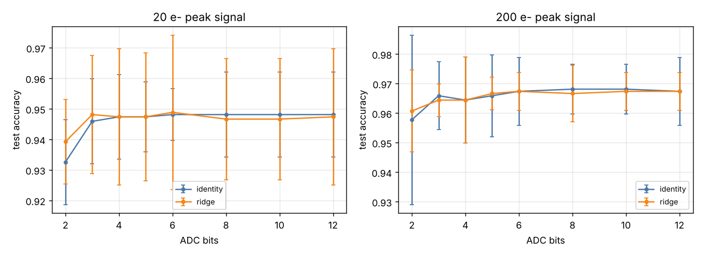

From 3 to 12 bits accuracy is flat within about one CI width at both exposures. At 2 bits it is lower (93.3% vs 94.8% at 20 e-; 95.8% vs 96.8% at 200 e- for the identity ISP), though the intervals overlap with only three seeds. The intuition is that once the ADC step `Δ` is below the shot-noise sigma (about `√N` electrons), extra bits only digitise noise more finely.

**Read noise** (3 seeds):

| e- | denoiser | read noise e- | acc % |
|---|---|---|---|
| 20 | identity | 0 | 95.1 ± 2.4 |
| 20 | identity | 1 | 95.0 ± 2.5 |
| 20 | identity | 2 | 94.8 ± 1.4 |
| 20 | identity | 4 | 93.0 ± 0.8 |
| 20 | identity | 8 | 84.3 ± 1.9 |
| 20 | identity | 16 | 60.6 ± 4.8 |
| 20 | ridge | 0 | 95.2 ± 2.1 |
| 20 | ridge | 1 | 95.2 ± 2.6 |
| 20 | ridge | 2 | 94.7 ± 2.0 |
| 20 | ridge | 4 | 93.6 ± 1.1 |
| 20 | ridge | 8 | 88.5 ± 3.0 |
| 20 | ridge | 16 | 71.0 ± 1.4 |
| 200 | identity | 0 | 96.8 ± 0.8 |
| 200 | identity | 1 | 96.8 ± 0.8 |
| 200 | identity | 2 | 96.8 ± 0.8 |
| 200 | identity | 4 | 96.6 ± 0.8 |
| 200 | identity | 8 | 96.4 ± 1.1 |
| 200 | identity | 16 | 96.1 ± 0.8 |
| 200 | ridge | 0 | 96.7 ± 1.0 |
| 200 | ridge | 1 | 96.7 ± 1.0 |
| 200 | ridge | 2 | 96.7 ± 0.6 |
| 200 | ridge | 4 | 96.7 ± 0.6 |
| 200 | ridge | 8 | 96.7 ± 0.6 |
| 200 | ridge | 16 | 96.4 ± 0.6 |

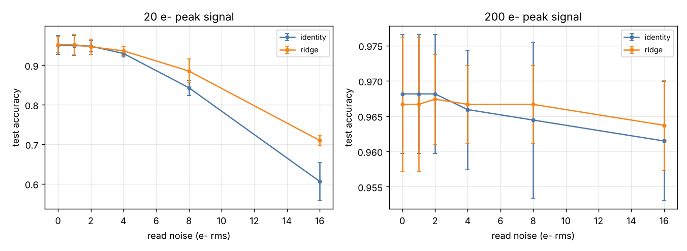

Read noise is negligible when it is below the shot noise (`σ_r ≲ √N`) and then collapses accuracy quickly: at 20 e-, 16 e- of read noise cuts the identity ISP to 60.6 ± 4.8%; `ridge` recovers it to 71.0 ± 1.4% (non-overlapping intervals). At 200 e- even 16 e- of read noise costs under one point.

**Classifier and integer quantisation** (3 seeds, `ridge` ISP):

| e- | classifier | acc % |
|---|---|---|
| 10 | mlp | 92.9 ± 3.9 |
| 10 | mlp_int4 | 92.4 ± 2.2 |
| 10 | mlp_int8 | 93.0 ± 3.0 |
| 10 | softmax | 93.0 ± 2.6 |
| 50 | mlp | 96.9 ± 0.0 |
| 50 | mlp_int4 | 96.4 ± 1.0 |
| 50 | mlp_int8 | 96.9 ± 0.0 |
| 50 | softmax | 96.1 ± 1.3 |
| 300 | mlp | 97.1 ± 2.4 |
| 300 | mlp_int4 | 96.9 ± 1.0 |
| 300 | mlp_int8 | 97.1 ± 2.5 |
| 300 | softmax | 96.5 ± 0.3 |

The int8 MLP agrees with its float parent at every exposure tested (accuracies identical at 50 and 300 e-, within 0.1 points at 10 e-). The float MLP scoring exactly 96.9% on all three seeds at 50 e- is a coincidence of counts (436/450 each time) rather than a bug: the seeds change the test split, noise and initialisation, and the other classifiers vary across seeds.

### Deployment budget

Per-frame cost with an int8 softmax classifier on the 16×16 frame (MACs; line-buffer SRAM at 2 bytes/pixel; classifier weights at 8 bits). Energy uses assumed constants (0.23 pJ per int8 MAC, 4.6 pJ per fp32 MAC; order-of-magnitude, **not measured here**). Host µs/img is NumPy latency on the machine that ran the experiment and is only meaningful as a relative cost:

| denoiser | MACs/frame | line buffer B | weights B (int8) | energy nJ (int8) | energy nJ (fp32) | acc % @20 e- | host µs/img |
|---|---|---|---|---|---|---|---|
| identity | 2560 | 0 | 2600 | 0.6 | 11.8 | 95.1 ± 0.7 | 0 |
| box | 4096 | 64 | 2600 | 0.9 | 18.8 | 95.0 ± 0.8 | 10 |
| gaussian | 5120 | 128 | 2600 | 1.2 | 23.6 | 94.9 ± 0.9 | 4 |
| median | 11776 | 64 | 2600 | 2.7 | 54.2 | 94.4 ± 0.8 | 42 |
| wiener | 17920 | 128 | 2600 | 4.1 | 82.4 | 94.9 ± 1.1 | 60 |
| gat | 8704 | 128 | 2600 | 2.0 | 40.0 | 94.7 ± 1.1 | 8 |
| ridge | 8960 | 128 | 2600 | 2.1 | 41.2 | 95.0 ± 0.9 | 10 |

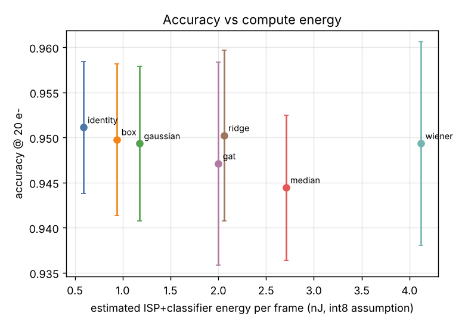

At 20 e- the identity ISP is on the Pareto front: it is the cheapest and statistically tied in accuracy with every denoiser. The classifier's 2560 MACs already dominate the cost of the cheap filters, so a 5×5 `ridge` filter (8960 MACs total here) raises the compute about 3.5× for no accuracy gain at this exposure but is justified below roughly 10 e-.

### Sensor characterisation from flat fields only

`python -m lowlight ptc` treats the simulator as an unknown camera, captures flat fields at 12 radiance levels (64 frames each) and recovers the system gain from the slope of temporal variance versus mean (EMVA 1288 style) and the dark noise floor from dark frames. For the 12-bit, 2000 e-, 3 e- read-noise configuration:

| quantity | estimated from flat fields | configured truth |
|---|---|---|
| system gain (DN per e-) | 1.6641 | 1.6488 |
| dark noise floor (e- rms) | 3.14 | 3.16 |
| linear-fit R² | 0.9988 | - |

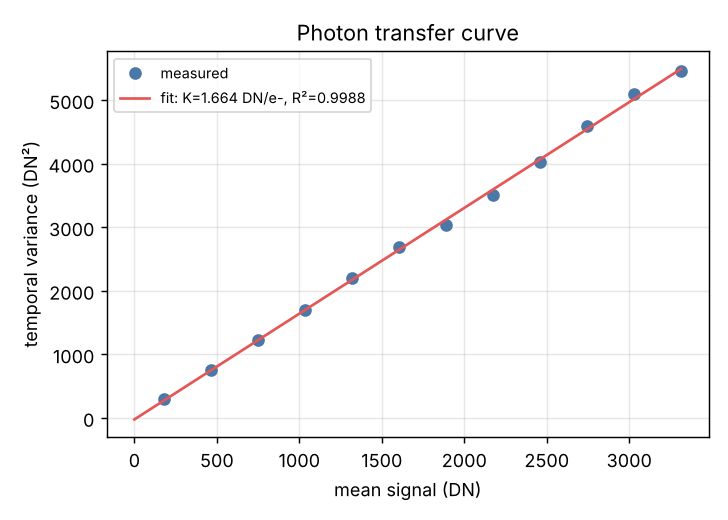

### Failure-case analysis

| quantity | value |
|---|---|
| exposure analysed | 5 e- |
| best method | ridge |
| top confusions (true→pred, count) | 8→1 (33); 1→8 (22); 9→3 (18); 3→9 (13); 2→8 (11); 6→1 (11) |
| test images wrong for every method | 8.133 ± 1.580 % |
| significantly harmful (e-, method, Δacc) | 20 e-, median, -0.7 pp; 100 e-, box, -0.6 pp; 100 e-, median, -0.5 pp; 300 e-, box, -0.4 pp; 300 e-, ridge, -0.2 pp |
| PSNR-winner ≠ accuracy-winner at | 10 e-, 20 e-, 50 e-, 100 e-, 300 e-, 1000 e- |

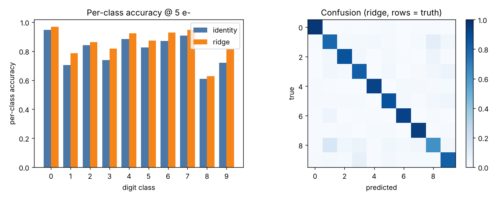

* **Structured confusions.** At 5 e- the dominant errors are 8→1 and 1→8, 9→3 / 3→9 and 2→8: classes whose upsampled 8×8 strokes differ in a handful of low-radiance pixels that photon noise erases. Digit 8 stays the hardest class even with the best denoiser (62.8% with `ridge`, 60.9% with the identity ISP); digit 1 improves from 70.4% to 78.7%.
* **Irreducible errors.** About 8.1 ± 1.6% of test images are misclassified by *all* seven pipelines at 5 e-, so ISP choice cannot fix them; more photons (longer exposure, larger pixels) or better optics would.
* **Harmful denoising.** Median at 20 and 100 e-, box at 100 and 300 e- and `ridge` at 300 e- are nominally significantly worse than the identity ISP (by 0.2 to 0.7 points; uncorrected, so exploratory). The common mechanism is smoothing of strokes that are already well resolved.
* **Metric disagreement.** PSNR keeps improving with denoising at high light even where accuracy does not, so tuning an ISP for PSNR/SSIM alone would spend compute without benefit to the downstream task.

## Limitations and threats to validity

* **One small task.** 16×16 digits are a toy proxy for vision at the edge; the digit strokes are low-pass (upsampled from 8×8), which favours smoothing filters more than natural textures would. Conclusions about *where* denoising stops helping should be re-measured on your own images.
* **Simulated sensor.** The noise model is textbook Poisson-Gaussian plus PRNU and ADC quantisation. It omits lens blur, rolling shutter, hot pixels, row/column noise, Bayer demosaicing, gamma and compression. The model is validated against its own theory (PTC, Fano factor), not against a physical camera.
* **Statistical power.** Five seeds on a 450-image test set give CIs of roughly ±1–4 points; no per-method comparison survives Holm correction, and the ADC/read-noise/classifier sweeps use only three seeds. Differences below about two points should not be over-interpreted.
* **Hyper-parameters** (Gaussian σ, GAT σ, ridge λ) are selected or fixed on training data; the classifier regularisation was not tuned per condition. The learned `ridge` filter is trained at the same exposure it is tested at.
* **Energy constants are assumptions.** Relative ordering of the denoisers follows MAC counts; absolute nJ values are only an order-of-magnitude illustration and ignore memory traffic, which usually dominates.
* **Host latency** is NumPy on a shared CPU, not microcontroller timing.
* **Seeds change many things at once** (split, noise, init), so the intervals mix sources of variance and cannot be attributed to one.

## Future work

* Replace the simulator with raw captures from a real sensor and re-run the PTC to calibrate `SensorConfig`.
* Add Bayer mosaics and demosaicing as another ISP stage; compare joint demosaic+denoise.
* Fixed-point implementations of the 5×5 `ridge` filter (coefficient bit-width sweep) and a cycle-level model on a Cortex-M-like core.
* Larger scenes (CIFAR-style natural images) and a small CNN classifier; patch-based non-local denoisers.
* Exposure bracketing / burst averaging as an alternative to spatial denoising.

## How to run

```bash
cd lowlight-sensor-inference-lab
pip install -r requirements.txt            # or: pip install -e ".[test]"
python -m pytest                           # 126 tests
python -m lowlight run --quick --out /tmp/quick   # ~1 min smoke run
python -m lowlight run --workers 2         # full study -> results/ (~5 min on 2 CPUs)
python -m lowlight report --out results    # re-render figures and tables from results.json
python -m lowlight budget                  # per-frame MAC / SRAM / energy table
python -m lowlight ptc --photons 2000      # photon-transfer characterisation
python -m lowlight demo --photons 5 --digit 3 --denoiser ridge   # ASCII-art capture
```

Outputs: `results/results.json` (aggregates), `results/records.json` (one row per trial), `results/tables.md`, `results/figures/*.png`, `results/ptc.json`, `results/config_resolved.json`. Continuous integration (`.github/workflows/ci.yml`; an active copy at the repository root) installs the package and runs the test-suite.

## Repository layout

```
lowlight-sensor-inference-lab/
├── lowlight/           package (layers 0-5, see table above)
├── tests/              unit, reference, structural (pyramid) and end-to-end tests
├── configs/            default.json (full study), quick.json (smoke run)
├── results/            JSON, tables and figures produced by `lowlight run`
├── pyproject.toml  requirements.txt  .github/workflows/ci.yml
```

## References

* F. J. Anscombe, "The transformation of Poisson, binomial and negative-binomial data," *Biometrika* 35, 1948.
* M. Mäkitalo and A. Foi, "Optimal inversion of the generalized Anscombe transformation for Poisson-Gaussian noise," *IEEE Trans. Image Processing* 22(1), 2013.
* A. Foi, M. Trimeche, V. Katkovnik, K. Egiazarian, "Practical Poissonian-Gaussian noise modeling and fitting for single-image raw-data," *IEEE Trans. Image Processing* 17(10), 2008.
* G. E. Healey and R. Kondepudy, "Radiometric CCD camera calibration and noise estimation," *IEEE Trans. Pattern Analysis and Machine Intelligence* 16(3), 1994.
* EMVA Standard 1288, "Standard for characterization of image sensors and cameras."
* J. S. Lim, *Two-Dimensional Signal and Image Processing*, Prentice Hall, 1990.
* M. Horowitz, "Computing's energy problem (and what we can do about it)," ISSCC 2014.
* E. Alpaydin and C. Kaynak, "Optical Recognition of Handwritten Digits," UCI Machine Learning Repository (distributed with scikit-learn as `load_digits`).
