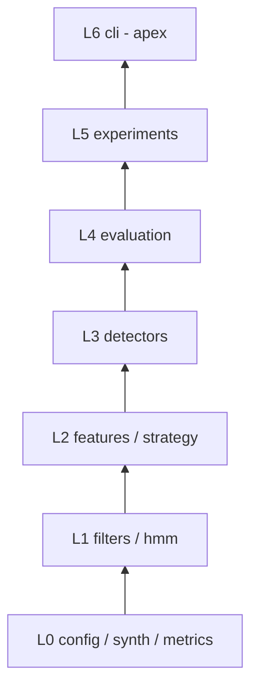
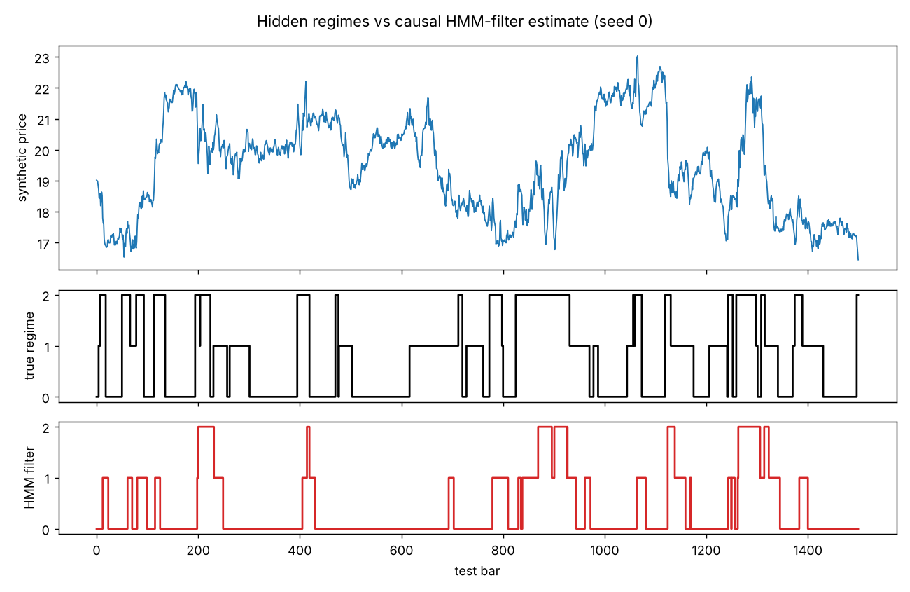
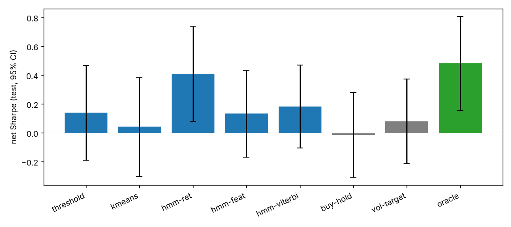
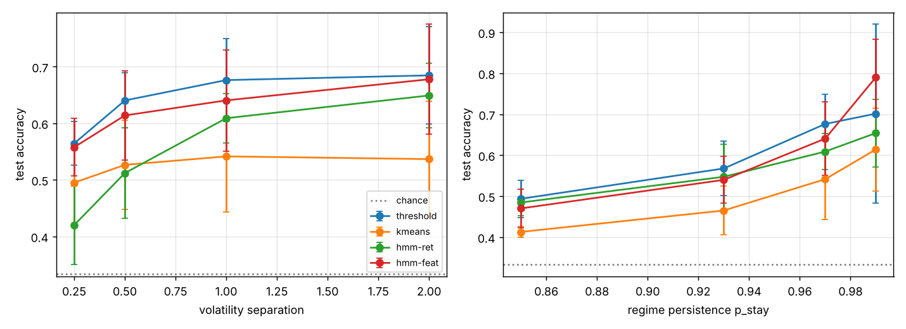
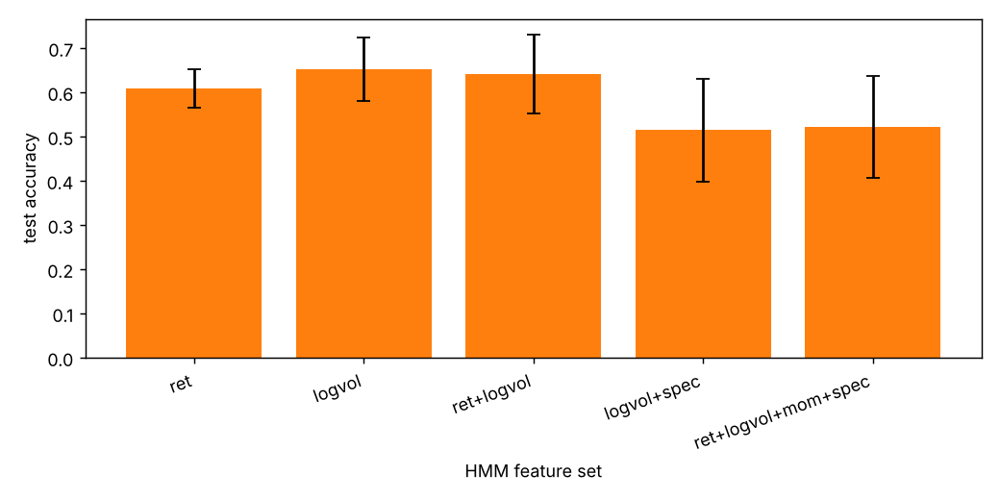
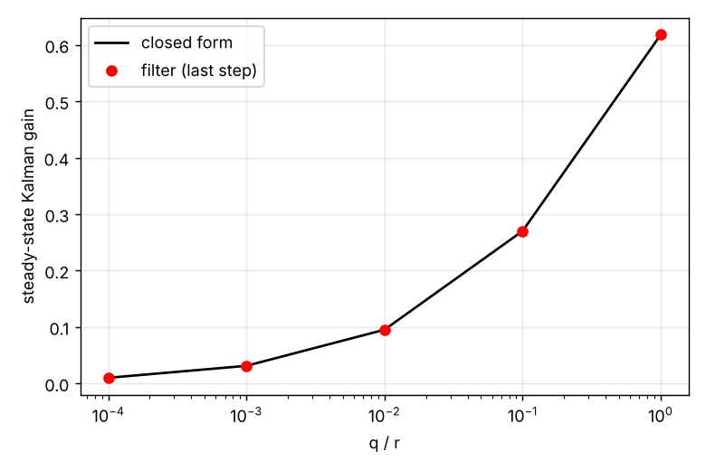

# regimelab: market-regime detection as a signal-processing problem

A synthetic-data lab that treats a return series as a noisy signal whose generating
"state" (calm / choppy / stressed) switches over time, and asks: **how well can causal
filters, clustering and a hidden Markov model recover that state, and does knowing it help
a simple exposure rule?** Everything is implemented from scratch in numpy/scipy (Baum-Welch,
Viterbi, a one-state Kalman filter, causal IIR/FIR filters, a rolling spectral feature) and
validated against independent references.

> **Not financial advice.** All data here is simulated. Nothing connects to a broker, places
> trades or uses real prices. The "strategy" is a toy used to turn detection quality into a
> number, and the simulated stressed regimes are *built* to have negative drift, so the P&L
> numbers say nothing about real markets.

## Motivation and ECE angle

Regime detection is state estimation. A latent discrete state `s_t` (a Markov chain) modulates
the variance, mean and autocorrelation of an observed signal `r_t`. That is the same structure
as a switching-noise sensor, a fading channel with good/bad states (Gilbert-Elliott), or speech
segments in an HMM recogniser. The ECE ideas exercised here:

- **Causal filtering** (EMA = single-pole IIR low-pass, Butterworth SOS, moving averages) and why
  causality (no look-ahead) is a testable property.
- **Spectral estimation**: a Hann-windowed rolling FFT feature that measures the fraction of power in
  the lowest eighth of the band, which separates momentum (positive autocorrelation) from mean reversion.
- **Kalman filtering**: local-level model with a closed-form steady-state gain.
- **HMMs**: scaled forward-backward, Baum-Welch EM, Viterbi (offline) vs forward filtering (causal, what
  a real-time system can use).
- **Engineering cost accounting**: per-bar inference latency and trading-style turnover costs.

## Method

Generative model, for regime `s_t ~ Markov(P)` with diagonal `p_stay`:

```
r_t = mu[s_t] + phi[s_t] * r_{t-1} + sigma[s_t] * eps_t,    eps_t ~ N(0, 1)
sigma[i] = 0.006 (1 + separation * i),  mu = linspace(+0.0006, -0.0010, k),  phi = ar_strength * linspace(-1, 1, k)
```

Local-level Kalman filter (`x_t = x_{t-1} + w`, `y_t = x_t + v`): the steady-state prior variance
solves `P^2 - qP - qr = 0`, giving gain `K = P / (P + r)`.

HMM filtering recursion (scaled): `alpha_t ∝ (alpha_{t-1} A) ⊙ b(x_t)`, with the regime estimate
`argmax_j alpha_t(j)` using only data up to `t`.

## Architecture (pyramid)

Modules are built strictly bottom-up and each imports only from layers below it;
`tests/test_pyramid.py` verifies the direction with `ast` and that the apex (`cli`) transitively
depends on every layer.



| Layer | Modules | Role |
|---|---|---|
| 0 | `config`, `synth`, `metrics` | JSON-validated config, Markov/AR/Gaussian generator, Hungarian label matching, delay, Sharpe, drawdown, t-CI |
| 1 | `filters`, `hmm` | EMA, SMA, Butterworth, rolling std, EWMA vol, rolling spectral fraction, Kalman, Gaussian HMM |
| 2 | `features`, `strategy` | causal standardised features; lagged exposure rule, costs, vol-target baseline |
| 3 | `detectors` | pluggable detectors (threshold, k-means, HMM filter, HMM Viterbi) and factory |
| 4 | `evaluation` | one-seed train/test run with accuracy, delay and strategy metrics |
| 5 | `experiments` | headline, sweeps, ablation, Kalman study, figures, markdown tables |
| 6 | `cli` | `run`, `sweep`, `demo`, `show-config` |

## How to run

```bash
pip install -r requirements.txt
python -m pytest -q                       # 55 tests
python -m regimelab run --out results     # full suite, ~20 s on a laptop-class CPU
python -m regimelab run --quick --seeds 2 # smoke run
python -m regimelab sweep --param separation --values 0.5 1 2
python -m regimelab demo
python -m regimelab show-config > cfg.json && python -m regimelab run --config cfg.json
```

## Experimental setup

`k=3` regimes, `p_stay=0.97`, `separation=1.0`, `ar_strength=0.15`, 2000 training bars, 1500 test
bars, 6 seeds for the headline table (4 seeds for sweeps and ablation), 5 bps one-way cost. Detectors are
fitted on the training segment and evaluated on the held-out test segment. Accuracy uses the best label
permutation (Hungarian). Delay is the mean number of bars until the prediction agrees with a newly
started true regime (censored at 50). Sharpe uses a lag-1 position (label at `t-1` sets exposure over bar `t`)
with exposures 1.0 / 0.5 / 0.0 for calm / choppy / stressed. All intervals are 95% Student-t over seeds
(mean ± half-width).

Detectors: `threshold` (EWMA volatility bucketed by training quantiles), `kmeans` (log-vol + spectral feature),
`hmm-ret` (HMM on raw returns), `hmm-feat` (HMM on returns + log-vol), `hmm-viterbi` (same features, offline
decode, **not causal**, an upper bound). Strategy baselines: `buy-hold`, `vol-target`, and `oracle` (true regime known).

## Results (generated by `python -m regimelab run`, also in `results/summary.md`)



| Method | Accuracy | Delay (bars) | Net Sharpe | Max DD | Turnover | Fit (s) | Predict (us/bar) |
|---|---|---|---|---|---|---|---|
| threshold | 0.681 ± 0.039 | 8.4 ± 1.4 | 0.14 ± 0.33 | -0.235 | 0.030 | 0.00 | 0.0 |
| kmeans | 0.546 ± 0.066 | 10.9 ± 3.0 | 0.04 ± 0.34 | -0.280 | 0.024 | 0.01 | 0.8 |
| hmm-ret | 0.615 ± 0.035 | 2.8 ± 1.1 | 0.41 ± 0.33 | -0.225 | 0.149 | 0.20 | 1.9 |
| hmm-feat | 0.668 ± 0.066 | 9.7 ± 1.6 | 0.13 ± 0.30 | -0.240 | 0.018 | 0.15 | 2.3 |
| hmm-viterbi | 0.690 ± 0.070 | 9.2 ± 1.7 | 0.18 ± 0.29 | -0.232 | 0.013 | 0.15 | 2.3 |
| buy-hold | - | - | -0.01 ± 0.29 | -0.501 | 0.000 | - | - |
| vol-target | - | - | 0.08 ± 0.29 | -0.496 | 0.031 | - | - |
| oracle | 1.000 ± 0.000 | 0.0 ± 0.0 | 0.48 ± 0.33 | -0.149 | 0.020 | - | - |



### Reading the headline table

- The simple volatility **threshold** baseline (0.68) is statistically indistinguishable from the HMM
  variants (0.62-0.69): intervals overlap heavily. On this synthetic problem, where regimes differ mostly in
  volatility, a well-tuned EWMA volatility estimate already captures most of the extractable information.
- The raw-return HMM reacts fastest (2.8 bars) but with lower accuracy and the highest turnover (0.149), which
  plausibly reflects a noisier, more flip-prone posterior argmax; this is an interpretation, not something tested
  separately here. It also has the highest Sharpe among detectors (0.41), but the interval (± 0.33) overlaps all
  other methods, including buy-and-hold.
- The non-causal Viterbi decode is only slightly better than the causal filter (0.690 vs 0.668), so on this setup
  the cost of causality is small relative to seed-to-seed spread.
- Even the oracle gets Sharpe 0.48 ± 0.33 over a 1500-bar test window, so Sharpe differences between detectors
  are within noise for this sample size. Accuracy and drawdown are more reliable signals than Sharpe here. Every
  regime-based rule has a smaller max drawdown (about -0.23) than buy-and-hold (-0.50), which is expected because
  the stressed regime is high-vol with negative drift by construction.

## Parameter sweeps



Accuracy vs volatility separation (4 seeds):

| separation | threshold | kmeans | hmm-ret | hmm-feat |
|---|---|---|---|---|
| 0.25 | 0.564 ± 0.039 | 0.495 ± 0.072 | 0.420 ± 0.069 | 0.558 ± 0.051 |
| 0.5 | 0.640 ± 0.048 | 0.526 ± 0.079 | 0.512 ± 0.080 | 0.614 ± 0.079 |
| 1.0 | 0.676 ± 0.073 | 0.541 ± 0.098 | 0.609 ± 0.044 | 0.641 ± 0.089 |
| 2.0 | 0.685 ± 0.086 | 0.537 ± 0.102 | 0.649 ± 0.057 | 0.678 ± 0.097 |

Accuracy vs regime persistence `p_stay`:

| p_stay | threshold | kmeans | hmm-ret | hmm-feat |
|---|---|---|---|---|
| 0.85 | 0.494 ± 0.046 | 0.413 ± 0.013 | 0.485 ± 0.033 | 0.470 ± 0.047 |
| 0.93 | 0.568 ± 0.067 | 0.465 ± 0.060 | 0.547 ± 0.080 | 0.540 ± 0.057 |
| 0.97 | 0.676 ± 0.073 | 0.541 ± 0.098 | 0.609 ± 0.044 | 0.641 ± 0.089 |
| 0.99 | 0.702 ± 0.218 | 0.614 ± 0.101 | 0.654 ± 0.083 | 0.790 ± 0.093 |

Observations: accuracy rises with both separation and persistence for every method, as expected (higher
signal-to-noise per regime, longer dwell time to average over). At small separation the return-only HMM falls
to 0.42 against a 0.33 chance level, while threshold and `hmm-feat` stay near 0.56. At `p_stay=0.99` `hmm-feat`
reaches 0.79, the largest gap over the threshold baseline (0.70), though with 4 seeds the threshold interval
(± 0.22) is wide enough that this is suggestive rather than established. k-means, which ignores temporal order,
is the weakest in every row.

## Ablation: which features does the HMM need?



| HMM features | Accuracy | Net Sharpe |
|---|---|---|
| ret | 0.609 ± 0.044 | 0.29 ± 0.37 |
| logvol | 0.652 ± 0.071 | -0.03 ± 0.34 |
| ret+logvol | 0.641 ± 0.089 | -0.02 ± 0.31 |
| logvol+spec | 0.514 ± 0.116 | -0.14 ± 0.38 |
| ret+logvol+mom+spec | 0.523 ± 0.115 | 0.10 ± 0.27 |

Adding the spectral and trend-score features **lowered** accuracy (0.64-0.65 down to about 0.51-0.52). With
`ar_strength=0.15` the autocorrelation differences are small compared with the sampling noise of a 64-bar windowed
spectrum, and in a diagonal-covariance Gaussian HMM the extra noisy dimensions compete with volatility for
state assignment. My first attempt used the full feature set as the default `hmm-feat` and it underperformed
(about 0.47 on one seed), which is why the shipped `hmm-feat` uses `ret+logvol`. That choice was made after
looking at one development seed, so the headline numbers are slightly optimistic for that detector relative to a
fully pre-registered choice.

## Kalman filter study



| q/r | gain empirical | gain theory | MSE kalman | MSE raw |
|---|---|---|---|---|
| 0.0001 | 0.0100 | 0.0100 | 0.0030 | 0.2542 |
| 0.001 | 0.0311 | 0.0311 | 0.0081 | 0.2468 |
| 0.01 | 0.0951 | 0.0951 | 0.0207 | 0.2493 |
| 0.1 | 0.2702 | 0.2702 | 0.0646 | 0.2550 |
| 1 | 0.6180 | 0.6180 | 0.1615 | 0.2625 |

The filter gain converges to the closed form, and the Kalman estimate always beats the raw observation in MSE;
the benefit shrinks as the process becomes noisier relative to the measurement (q/r near 1).

## Validation against references

Measured by `tests/test_reference.py` (`measure()` returns the max error of each comparison; tests assert tolerances).

| Quantity | Reference | Max error measured |
|---|---|---|
| Steady-state Kalman gain | `scipy.linalg.solve_discrete_are` | 5.6e-17 |
| Causal Butterworth | `scipy.signal.lfilter` with `lfilter_zi` | 6.7e-16 |
| HMM emission log-density | `scipy.stats.multivariate_normal` | 5.3e-15 |
| 1-state HMM log-likelihood | `scipy.stats.norm.logpdf` sum | 1.1e-13 |
| Stationary distribution | row of `P^300` (`numpy.linalg.matrix_power`) | 1.8e-15 |
| Label matching accuracy | brute force over all permutations | 0 |
| t confidence interval | `scipy.stats.t.interval` | 0 (to float precision) |
| Welch band power | `numpy.trapezoid` over `scipy.signal.welch` | 0 |
| EMA | explicit recursion | 4.4e-16 |
| Rolling std | `numpy.std(ddof=1)` on the window | 0 |

In `tests/test_layer1.py` the scaled forward algorithm, Viterbi path and smoothed posteriors are compared with
exhaustive path enumeration (2^5 to 2^6 paths) to within 1e-10, Baum-Welch log-likelihood is checked to be
non-decreasing, and parameter recovery on a 2-state series is within 15% of the true sigmas.

## Tests

55 tests cover: generator statistics, Markov chain empirics, config validation, label matching, delay on a known
case, filter causality (changing the future never changes the past), HMM exactness and numerical stability for
extreme inputs, feature causality, detector causality, cost accounting, the pyramid dependency direction, and a
quick end-to-end CLI run that writes all artifacts.

## Limitations and threats to validity

- **Synthetic data only.** The generator is exactly an HMM, so HMM detectors are correctly specified here. Real
  returns have fat tails, volatility clustering inside regimes and non-stationary dynamics; the accuracy numbers
  should not be read as predictions for real markets.
- Regimes are *constructed* to have negative drift when volatile, which is what makes de-risking pay off. Real
  markets offer no such guarantee.
- Seeds are few (4-6), so most intervals are wide. Many differences between methods, and almost every Sharpe
  comparison, are within noise. Only coarse trends (accuracy rising with separation and persistence, k-means being
  weakest) are consistently visible.
- The HMM uses diagonal covariances and Gaussian emissions; the threshold baseline is not tuned beyond training-set
  quantiles with equal occupancy assumed.
- The `hmm-feat` feature choice was informed by a single development seed (see ablation).
- Detection accuracy is label-permutation matched on the test set, which is mildly optimistic compared with a fixed
  mapping; `hmm-*` and `kmeans` order labels by volatility so the fixed mapping is usually the identity anyway.
- Sharpe is computed from a short test window with no risk-free rate; it is a relative diagnostic only.

## Future work

Student-t or GARCH emissions, explicit-duration (semi-Markov) HMMs, online EM updates, comparison with a
change-point method such as Bayesian online change-point detection, evaluating on a public dataset with
known-labelled regimes (for example sensor fault data) to test the signal-processing view outside finance, and a
fixed-point implementation of the forward recursion for a microcontroller budget.
